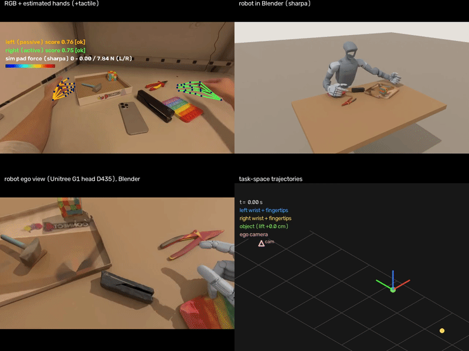
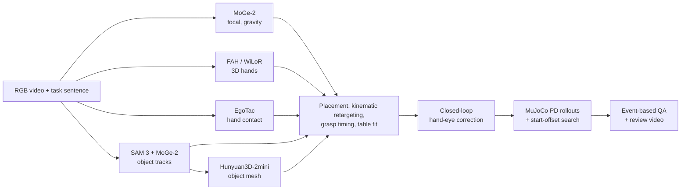

<div align="center">

# Ego2Humanoid

**From a single egocentric RGB video to physically validated humanoid manipulation**

[](LICENSE)
[](pyproject.toml)
[](https://mujoco.org)
[](https://github.com/astral-sh/ruff)



<sub><i>EgoDex clip 0, "pick up the black stapler and place it in the box lid". Top left: input RGB with estimated
hands. Top right: third-person view of the Unitree G1 with Sharpa Wave hands. Bottom left: the robot's head-camera
view of the simulation. Bottom right: task-space trajectories. Full resolution:
<a href="docs/assets/clip0_result_grid.mp4"><code>clip0_result_grid.mp4</code></a>.</i></sub>

</div>

## Abstract

Egocentric human video is an abundant source of manipulation demonstrations, but it has no robot actions, no
contact forces and no metric 3D scene. **Ego2Humanoid** turns one egocentric RGB clip of a person doing a
pick-and-place task, plus a one-sentence task description, into a physically executed humanoid demonstration. The
pipeline combines monocular geometry, 3D hand, vision-to-tactile and open-vocabulary object perception with
image-to-3D asset generation. It then retargets the hand motion kinematically onto a fixed-pelvis Unitree G1 with
either a Dex3-1 or a five-finger Sharpa Wave hand, corrects the robot's grasp point in closed loop against the
perceived object, and replays the result with PD control in MuJoCo [[13]](#ref13). A run is accepted only when
independent pick, lift, carry, place and settle events are detected on the *achieved* object state of an
action-controlled rollout; the simulator state is never written after reset. Dataset ground truth is used only
for clip selection and evaluation, never as an input.

## Highlights

- **RGB-only input.** One egocentric MP4 and a task sentence; no depth, IMU, motion capture or tactile gloves.
- **Two embodiments.** Unitree G1 (29 DoF) with Dex3-1 (43 actuators in total) or Sharpa Wave (73 actuators,
  tactile pads).
- **Physics, not playback.** Acceptance requires a contact-driven MuJoCo rollout under joint-target control,
  enforced by a state-injection guard (see [Replay contract](docs/ARCHITECTURE.md#4-replay-semantics-and-anti-cheating-contract)).
- **Tactile-informed timing.** Grip closure and release are timed from vision-predicted hand contact
  (EgoTac [[7]](#ref7)).
- **Agentic real-to-sim tuning.** Physical and planning constants are exposed as a typed `SimParams` overlay; a
  simulator-agnostic loop re-simulates a clip and returns spatio-temporal feedback
  ([§4.11 of the design](docs/TECH_DESIGN.md#411-parameter-tunable-real2sim-loop-track-rsi-rsi-skillsparams-skills)).
- **Reproducible stages.** One Docker image per perception or robot stage, pinned submodules, `uv` lockfiles and
  versioned data contracts.

## Contents

1. [Method](#method)
2. [Results](#results)
3. [Installation](#installation)
4. [Quick start: clip 0 from scratch](#quick-start-clip-0-from-scratch)
5. [Outputs](#outputs)
6. [Tuning and diagnosis](#tuning-and-diagnosis)
7. [Troubleshooting](#troubleshooting)
8. [Repository layout and documentation](#repository-layout-and-documentation)
9. [Testing](#testing)
10. [Limitations](#limitations)
11. [Citation](#citation)
12. [References](#references)
13. [License and acknowledgements](#license-and-acknowledgements)

## Method



**Perception (RGB only).** MoGe-2 [[2]](#ref2) estimates the focal length, the gravity direction and a metric-scale
point map. 3D hands come from FAH [[3]](#ref3), which builds on the hand branch of SAM 3D Body [[4]](#ref4), or from
WiLoR [[5]](#ref5) when the FAH weights are unavailable; both use the MANO hand model [[6]](#ref6). EgoTac
[[7]](#ref7) predicts per-vertex hand contact and force. The manipulated object and the receptacle are segmented
with SAM 3 [[8]](#ref8) (or OWLv2 [[9]](#ref9) + SAM [[10]](#ref10)), lifted to 3D with MoGe-2, and the held object
is reconstructed with Hunyuan3D-2mini [[11]](#ref11). Collision geometry is decomposed with CoACD [[12]](#ref12).

**Retargeting and alignment.** The fixed-pelvis robot is placed and its waist pitched so that its head camera
(a RealSense D435) sees the hands as the person's camera did. Wrist poses are solved by arm inverse kinematics;
fingertips are mapped by a finger-correspondence table with a dedicated pinch solver, pinch levelling and roll
alignment. The grip is timed from the EgoTac contact signal, a synthetic table is fitted to the robot, and the
robot's own pinch point is then corrected onto the object and the receptacle in closed loop. Unlike
sampling-based physics retargeting such as SPIDER [[15]](#ref15), which the original design used, the as-built
pipeline is kinematic and relies on the physics rollout only for validation and start-offset search
([deviations](docs/TECH_DESIGN.md#9-deviations-from-the-v03-plan)).

**Simulation and acceptance.** The plan is executed in MuJoCo [[13]](#ref13) with PD position actuators at 500 Hz
physics and 50 Hz control. The object start pose is searched over 25 candidates within ±3 cm; every candidate is a
full action-controlled rollout. Success is decided by independent pick-place event detectors on the achieved
object trajectory. Review videos are rendered from the stepped simulation, with Blender used for the digital-twin
views.

A full, code-accurate description is in [`docs/TECH_DESIGN.md`](docs/TECH_DESIGN.md); the retargeting chain is
explained step by step in [`docs/RETARGETING.md`](docs/RETARGETING.md).

## Results

Development uses the `basic_pick_place` split of EgoDex [[1]](#ref1), test clips 0, 1, 10, 100, 101, 104, 108, 114,
116 and 117. With default parameters and the Sharpa Wave hand, clip 0 succeeds with a final place error of
3.88 cm (animation above).

| Clip | Hand | Outcome | Place error |
|---|---|---|---|
| 0 | Sharpa Wave | success | 3.88 cm |

Earlier ten-clip batches, the failure taxonomy and a physical-fidelity audit (object drift, pad-force saturation)
are recorded in [`docs/notes/batch_results.md`](docs/notes/batch_results.md). Those snapshots predate several
fixes; rerun the pipeline for current numbers.

## Installation

**Requirements.** Linux with an NVIDIA GPU (a 16 GB T4 suffices), Docker with `docker run --gpus all`,
[`uv`](https://github.com/astral-sh/uv), `git`, the Hugging Face `hf` CLI, and about 60 GB of free disk (images
about 40 GB, weights about 12 GB).

**Gated assets** (manual, once):

- Accept the licence of [`facebook/sam3`](https://huggingface.co/facebook/sam3) on Hugging Face and run
  `hf auth login`. The default `HF_HOME` is `/mnt/tmp/hfcache`; set `HF_HOME` if that path does not exist.
- Register for MANO [[6]](#ref6) at <https://mano.is.tue.mpg.de> and place `MANO_RIGHT.pkl` in
  `third_party/WiLoR/mano_data/` (WiLoR hands, the default). For FAH, place the cleaned MANO in
  `assets/mano/clean` (`MANO_SRC`).

**Setup.** `scripts/setup_usecase0.sh` performs every step below in one go (idempotent; `--no-build` skips the
Docker images). EgoDex clips are downloaded from the official source and never redistributed (CC-BY-NC-ND).

```bash
git clone --recurse-submodules https://github.com/kevinlisun/ego2humanoid.git && cd ego2humanoid
export UV_LINK_MODE=copy                                       # needed on network file systems

# 1. Stage images (one per stage), about 40 GB
for n in perception hands tactile retarget; do scripts/build_node.sh $n; done
docker build -f nodes/hands/Dockerfile --target wilor -t ego2humanoid/hands-wilor:dev .   # WiLoR hand node

# 2. Raw EgoDex clips (remote zip, no 16 GB download; keeps the 12 clips accepted by the selector)
uv run --frozen --extra egodex python scripts/fetch_egodex.py basic_pick_place -n 12

# 3. Robot models (Unitree G1 + Dex3, Sharpa Wave); meshes are git-ignored
bash scripts/fetch_g1_assets.sh && bash scripts/fetch_sharpa_assets.sh

# 4. Model weights
hf download tencent/Hunyuan3D-2mini --local-dir data/weights/hunyuan3d/Hunyuan3D-2mini \
  --include "config.json" "hunyuan3d-dit-v2-mini/*" "hunyuan3d-vae-v2-mini/*"        # about 8 GB (territorial licence, see docs/LICENSES.md)
hf download wkzhang/EgoTac egotac_base_h4.pt --local-dir data/weights/egotac           # tactile, 0.9 GB
hf download facebook/sam3                                                              # gated, into $HF_HOME
hf download Ruicheng/moge-2-vitl-normal                                                # MoGe-2, into $HF_HOME
for f in detector.pt wilor_final.ckpt; do                                              # WiLoR hands, 2.6 GB
  curl -L -o third_party/WiLoR/pretrained_models/$f \
    https://huggingface.co/spaces/rolpotamias/WiLoR/resolve/main/pretrained_models/$f; done
```

**Hand estimator.** The default recipe uses WiLoR [[5]](#ref5) (public weights), selected with
`FAH_PY=/nonexistent`. For the more accurate FAH [[3]](#ref3), also run
`hf download noahcao/FAH --exclude "qc/*" --local-dir data/weights/fah`, provide the code in `third_party/FAH`, the
cleaned MANO in `assets/mano/clean` and an `HF_TOKEN` with the SAM 3D Body licence accepted (for
`fah.download_sam3d`), then drop `FAH_PY=/nonexistent`. Without SAM 3 access use `OBJ_DETECTOR=owl`; the
`held_mesh` stage still requires SAM 3. The tactile stage is skipped when the EgoTac weights are absent.

## Quick start: clip 0 from scratch

The task is *"pick up a black stapler from the table and place it in the box lid"* (EgoDex clip 0). Every stage
runs in its own Docker image (`DOCKER=1`).

```bash
DOCKER=1 FAH_PY=/nonexistent HF_HOME=/mnt/tmp/hfcache LOG_DIR=/tmp/e2h_clip0 scripts/run_pipeline.sh 0
LOG_DIR=/tmp/e2h_clip0 watch -n 30 scripts/pipeline_progress.sh 0   # progress, in a second terminal
```

Finished stages are skipped. `FORCE=1` reruns all stages, `DRY_RUN=1` prints the commands, `STAGES=retarget` runs
only the robot part, `RENDER=0` is about twice as fast (no video) and `HAND=dex3` switches the hand. Several clips
run in parallel with `JOBS=4 scripts/run_pipeline.sh 0 1 10 100`. On a T4 with WiLoR and rendering enabled,
perception takes about 10 min and the robot part with video about 8 min (excluding first-time weight downloads).
All runner options are documented in [`run_pipeline.md`](run_pipeline.md).

| # | Stage | Image | Output in `data/derived/egodex/basic_pick_place_0/` |
|---|---|---|---|
| 1 | `export` | retarget | `episode.json`, `video.mp4`, `gt/egodex_gt.npz` |
| 2 | `intrinsics` | perception | `intrinsics_est.json` (MoGe-2 focal, about 782 px) |
| 3 | `gravity` | perception | `gravity_est.json` |
| 4 | `hands` | hands | `hands_fah_f<focal>.npz` |
| 5 | `tactile` | tactile | `tactile_egotac.npz` |
| 6 | `objects` | perception | `objects_sam3.npz` |
| 7 | `scene` | perception | `scene/inventory.json`, `points.npz`, `crop_*.png` |
| 8 | `scene_mesh` | perception | `scene/mesh_*.glb` |
| 9 | `held_mesh` | perception + retarget | `object_mesh_raw.glb` (a first retarget pass selects the crop frames) |
| 10 | `retarget` | retarget | `retarget_rgb_sharpa.{json,npz}`, `scene_sim.pkl`, `sim_tactile_sharpa.npz`, `review/*` |

**Checking the result.**

```bash
python3 -c "
import json
d = json.load(open('data/derived/egodex/basic_pick_place_0/retarget_rgb_sharpa.json'))
e = d['perceived_object']['sim_events']
print({k: e.get(k) for k in ('success', 'failure_reasons', 'place_error_m')})"
```

Expected with default parameters: `success: True` and a place error of about 3.8 cm. The review video is
`review/result_grid_sharpa.mp4`; the batch table is written to `$LOG_DIR/batch_results.md`.

**Running the robot part directly** (outside Docker, perception already done):

```bash
MUJOCO_GL=egl HAND=sharpa RENDER=1 \
  uv run --frozen --extra video --extra sim --extra hands --extra objects --extra egodex \
  python scripts/retarget_estimated.py data/derived/egodex/basic_pick_place_104
uv run --frozen python scripts/summarize_batch.py   # table over all clips
```

## Outputs

Each clip directory `data/derived/egodex/<clip>/` (about 350 MB, git-ignored) contains:

| Group | Files |
|---|---|
| Inputs and ground truth | `video.mp4`; `episode.json` (task text, robot id, scale policy); `gt/egodex_gt.npz` (EgoDex camera poses and 21-joint hands, evaluation only) |
| Perception | `intrinsics_est.json`, `gravity_est.json`; `hands_fah_f<focal>.npz` (joints `(T,2,21,3)`, 2D joints, scores, validity); `hand_eval*.json` (error against ground truth); `tactile_egotac.npz` and `alignment/` (pressure, contact flags, grasp timing); `objects_sam3.npz` (masks, centroids, depth); `object_crop.png`, `object_mesh_raw.glb`; `scene/` (inventory, point cloud, per-object crop and mesh) |
| Retargeting and simulation | `retarget_rgb_sharpa.json` (perceived object, hold window, tactile timing, `sim_events` with `success` / `failure_reasons` / `place_error_m`, `sim_params_hash`); `retarget_rgb_sharpa.npz` (joint targets `q_target_rad (T,73)`); `scene_sim.pkl`; `sim_tactile_sharpa.npz` (force and contact `(T,2,11)`); `real2sim_sharpa/sim_bundle.{json,npz}`; optional `loco_manip_result.json` |
| Review | `review/result_grid_sharpa.{mp4,gif}` (2×2 grid); `third_blender.mp4`, `ego_blender.mp4`, `panels/`; `trajectory_sharpa.npz` (wrist, fingertips, object pose, camera transform); `sim_state_sharpa.npz`, `sim_model/`, `twin_scene/` |
| Scratch (safe to delete) | `*_bt_<stamp>.*`, `hands_fah_f{500,773,781,1000,1500}.npz`, `hands_fah_gtk.npz`, `orig/`, `real2sim/`, `*.bak_*` |

Large render intermediates go to `$E2H_BULK_DIR` (default `/cloudfile/nvme_tmp/egodex/<clip>/panels`). The
artifact and array contracts are specified in [`docs/DATA_CONTRACTS.md`](docs/DATA_CONTRACTS.md); the data layout
in [`data/README.md`](data/README.md).

## Tuning and diagnosis

When a clip fails, the real-to-sim skills in [`src/skills/`](src/skills/) map the failure reasons to a diagnosis
and a `SimParams` correction (`scene_layout`, `asset_provenance`, `receptacle_check`, `reachability_check`; see
[`docs/notes/skills_library.md`](docs/notes/skills_library.md)). Parameters are changed through a YAML overlay on
[`configs/sim_params/default.yaml`](configs/sim_params/default.yaml), never by editing code:

```bash
printf 'trajectory:\n  receptacle_opening_margin_m: 0.03\n' > /tmp/overlay.yaml
DOCKER=1 STAGES=retarget E2H_SIM_PARAMS=$(readlink -f /tmp/overlay.yaml) scripts/run_pipeline.sh 0
```

The overlay path must be a real path visible inside Docker. `scripts/real2sim_eval.py` (agent-driven) and
`scripts/real2sim_loop.py` (file relay) run the same loop programmatically; it reaches the simulator only through
the `SimBackend` protocol ([playbook](docs/notes/agentic_real2sim.md)). An optional loco-manipulation episode,
using the decoupled whole-body controller of GR00T [[17]](#ref17), is produced by
`nodes/bin/retarget-python scripts/loco_manip_episode.py --clip basic_pick_place_0 --jobs 1`
(`loco_manip_result.json`, `review/loco_manip.mp4`).

## Troubleshooting

| Symptom | Fix |
|---|---|
| `missing .../0.hdf5` | Run `scripts/fetch_egodex.py`. |
| `No module named 'remotezip'` | Use `--extra egodex` (it includes `remotezip`). |
| `Error opening file 'meshes/...STL'` | Run `scripts/fetch_g1_assets.sh` and `scripts/fetch_sharpa_assets.sh`. |
| `No module named 'infer'` / `common.pytorch_util` (tactile) | `git submodule update --init third_party/EgoTac`; the tactile node must run with an empty `PYTHONPATH` (handled by `scripts/node_python.sh`). |
| `WEIGHTS_NOT_FOUND ... set HF_HOME` | Point `HF_HOME` at the cache that holds `facebook/sam3`. |
| `No module named 'fah'` / FAH weights not found | Set `FAH_SRC` and `FAH_WEIGHTS_SRC`, or use WiLoR via `FAH_PY=/nonexistent`. |
| `sam-3d-body-dinov3/model_config.yaml missing` | Accept the SAM 3D Body licence, set `HF_TOKEN`, run `fah.download_sam3d`. |
| `E2H_SIM_PARAMS` not found in the container | Use the resolved path (`readlink -f`). |
| Result looks stale | Delete `review/` and rerun with `FORCE=1 STAGES=retarget`. |

## Repository layout and documentation

```text
ego2humanoid/
├── src/            # library: contracts, robot models, stages (reconstruction, retargeting, manipulation,
│                   # locomotion, qa), real-to-sim loop (rsi, skills), orchestration, CLI
├── scripts/        # per-clip entry points: run_pipeline.sh, retarget_estimated.py, fetch_*, real2sim_*
├── nodes/          # one Docker image per stage: perception, hands, tactile, retarget
├── configs/        # versioned configuration (SimParams defaults, scenarios, grasp tables)
├── contracts/      # JSON schemas of the data contracts
├── assets/         # robot MJCF (G1 + Dex3, Sharpa Wave), small static assets
├── tests/          # unit, smoke, module and system tests
├── third_party/    # pinned git submodules (FAH, SPIDER, SimFoundry, EgoTac, GR00T-WBC, MuJoCo, WiLoR)
└── docs/           # design documents, notes, archived plans
```

| Document | Purpose |
|---|---|
| [`docs/TECH_DESIGN.md`](docs/TECH_DESIGN.md) | Technical design as built: invariants, perception, retargeting, simulation, constants |
| [`docs/RETARGETING.md`](docs/RETARGETING.md) | Contributor guide to the retargeting chain |
| [`docs/ARCHITECTURE.md`](docs/ARCHITECTURE.md) | System shape, frame conventions, robot models, replay contract |
| [`docs/DATA_CONTRACTS.md`](docs/DATA_CONTRACTS.md) | Artifact and array contracts (v1.2) |
| [`docs/LICENSES.md`](docs/LICENSES.md) | Licence register of third-party code, models and data |
| [`run_pipeline.md`](run_pipeline.md) | Runner options, prerequisites and per-stage outputs |
| [`CONTRIBUTING.md`](CONTRIBUTING.md) | Development workflow, coding standards, tests |

Development records (`AGENTS.md`, `HARNESS.md`, `TASKS.md`, `docs/notes/`, `docs/archive/`) document the project history, open questions and the original v0.2/v0.3 plans.

## Testing

```bash
MUJOCO_GL=egl uv run --frozen --extra video --extra sim --extra hands --extra objects --extra egodex \
  python -m pytest tests -q
uv run --frozen ruff check src scripts tests && uv run --frozen ruff format --check src scripts tests
```

Tests are organised by scope (`unit`, `smoke`, `module`, `system`); tests that need real data or a GPU are marked
and skipped automatically when the resource is missing ([`tests/README.md`](tests/README.md)).

## Limitations

- **Scale and geometry are estimated.** Monocular depth is rescaled by a wrist-depth ratio and is not metric
  ground truth. A physics success means the robot succeeds *in the estimated scene*, not that real masses,
  frictions or forces were recovered.
- **Physical fidelity is still being tuned.** The fidelity audit in
  [`docs/notes/batch_results.md`](docs/notes/batch_results.md) shows pad forces above the sensor range and object
  drift on several clips.
- **Scope.** Single-arm-dominant tabletop pick-and-place, fixed pelvis, one object held at a time.
- **Licences.** Several components (EgoDex, WiLoR, FAH weights, SPIDER, SAM 3) are restricted to non-commercial
  research, and the Hunyuan3D-2mini licence excludes the EU, the UK and South Korea; see
  [`docs/LICENSES.md`](docs/LICENSES.md).

## Citation

If you use this code, please cite the repository (see also [`CITATION.cff`](CITATION.cff)) and the works it builds
on, listed below.

```bibtex
@software{ego2humanoid2026,
  title  = {{Ego2Humanoid}: From Egocentric {RGB} Video to Physically Validated Humanoid Manipulation},
  author = {kevinlisun},
  year   = {2026},
  url    = {https://github.com/kevinlisun/ego2humanoid},
  note   = {Version 0.3.0}
}
```

## References

1. <a id="ref1"></a>R. Hoque, P. Huang, D. J. Yoon, M. Sivapurapu, J. Zhang. *EgoDex: Learning Dexterous Manipulation from Large-Scale Egocentric Video.* arXiv:2505.11709, 2025. [[paper]](https://arxiv.org/abs/2505.11709) [[code]](https://github.com/apple/ml-egodex)
2. <a id="ref2"></a>R. Wang, S. Xu, Y. Dong, Y. Deng, J. Xiang, Z. Lv, G. Sun, X. Tong, J. Yang. *MoGe-2: Accurate Monocular Geometry with Metric Scale and Sharp Details.* NeurIPS, 2025. [[paper]](https://arxiv.org/abs/2507.02546) [[code]](https://github.com/microsoft/MoGe)
3. <a id="ref3"></a>J. Cao. *Fast and Accurate Hand Estimation in Pixels, Interaction and World Space.* arXiv:2611.07711, 2026. [[paper]](https://arxiv.org/abs/2611.07711) [[code]](https://github.com/noahcao/FAH)
4. <a id="ref4"></a>X. Yang, D. Kukreja, D. Pinkus, et al. *SAM 3D Body: Robust Full-Body Human Mesh Recovery.* CVPR, 2026. [[paper]](https://arxiv.org/abs/2602.15989) [[code]](https://github.com/facebookresearch/sam-3d-body)
5. <a id="ref5"></a>R. A. Potamias, J. Zhang, J. Deng, S. Zafeiriou. *WiLoR: End-to-end 3D Hand Localization and Reconstruction in-the-wild.* CVPR, 2025. [[paper]](https://arxiv.org/abs/2409.12259) [[code]](https://github.com/rolpotamias/WiLoR)
6. <a id="ref6"></a>J. Romero, D. Tzionas, M. J. Black. *Embodied Hands: Modeling and Capturing Hands and Bodies Together.* ACM Transactions on Graphics (SIGGRAPH Asia), 36(6), 2017. [[project]](https://mano.is.tue.mpg.de)
7. <a id="ref7"></a>W. Zhang, C. Yuan, Z. Zhang, Z. Cheng, Y. Gao. *EgoTac: In-the-wild Tactile Prediction from Egocentric Vision.* arXiv:2608.15060, 2026. [[paper]](https://arxiv.org/abs/2608.15060) [[project]](https://egotac.github.io/)
8. <a id="ref8"></a>N. Carion, L. Gustafson, Y.-T. Hu, et al. *SAM 3: Segment Anything with Concepts.* ICLR, 2026. [[paper]](https://arxiv.org/abs/2511.16719) [[code]](https://github.com/facebookresearch/sam3)
9. <a id="ref9"></a>M. Minderer, A. Gritsenko, N. Houlsby. *Scaling Open-Vocabulary Object Detection.* NeurIPS, 2023. [[paper]](https://arxiv.org/abs/2306.09683)
10. <a id="ref10"></a>A. Kirillov, E. Mintun, N. Ravi, et al. *Segment Anything.* ICCV, 2023. [[paper]](https://arxiv.org/abs/2304.02643)
11. <a id="ref11"></a>Tencent Hunyuan3D Team. *Hunyuan3D 2.0: Scaling Diffusion Models for High Resolution Textured 3D Assets Generation.* arXiv:2501.12202, 2025. [[paper]](https://arxiv.org/abs/2501.12202) [[code]](https://github.com/Tencent-Hunyuan/Hunyuan3D-2)
12. <a id="ref12"></a>X. Wei, M. Liu, Z. Ling, H. Su. *Approximate Convex Decomposition for 3D Meshes with Collision-Aware Concavity and Tree Search.* ACM Transactions on Graphics (SIGGRAPH), 41(4), 2022. [[code]](https://github.com/SarahWeiii/CoACD)
13. <a id="ref13"></a>E. Todorov, T. Erez, Y. Tassa. *MuJoCo: A Physics Engine for Model-Based Control.* IEEE/RSJ IROS, 2012. [[code]](https://github.com/google-deepmind/mujoco)
14. <a id="ref14"></a>K. Zakka, Y. Tassa, and MuJoCo Menagerie Contributors. *MuJoCo Menagerie: A Collection of High-Quality Simulation Models for MuJoCo.* 2022. [[code]](https://github.com/google-deepmind/mujoco_menagerie)
15. <a id="ref15"></a>C. Pan, C. Wang, H. Qi, Z. Liu, H. Bharadhwaj, A. Sharma, T. Wu, G. Shi, J. Malik, F. Hogan. *SPIDER: Scalable Physics-Informed Dexterous Retargeting.* arXiv:2511.09484, 2025. [[paper]](https://arxiv.org/abs/2511.09484) [[code]](https://github.com/facebookresearch/spider)
16. <a id="ref16"></a>NVIDIA GEAR. *SimFoundry: Modular and Automated Scene Generation for Policy Learning and Evaluation.* arXiv:2606.28276, 2026. [[paper]](https://arxiv.org/abs/2606.28276) [[code]](https://github.com/NVlabs/SimFoundry)
17. <a id="ref17"></a>NVIDIA, J. Bjorck, F. Castañeda, et al. *GR00T N1: An Open Foundation Model for Generalist Humanoid Robots.* arXiv:2503.14734, 2025. [[paper]](https://arxiv.org/abs/2503.14734) [[WBC code]](https://github.com/NVlabs/GR00T-WholeBodyControl)

## License and acknowledgements

The code in this repository is released under the [Apache License 2.0](LICENSE) (see also [`NOTICE`](NOTICE)).
Third-party data, models and submodules keep their own licences, several of them non-commercial: EgoDex
(CC-BY-NC-ND), WiLoR (CC-BY-NC-ND), FAH weights, EgoTac, SPIDER (CC-BY-NC 4.0) and SAM 3. The Hunyuan3D-2mini
licence does not apply in the EU, the UK or South Korea. The full register is
[`docs/LICENSES.md`](docs/LICENSES.md).

This project builds directly on the open releases of EgoDex, MoGe, FAH, SAM 3D Body, WiLoR, EgoTac, SAM 3,
Hunyuan3D, CoACD, MuJoCo, MuJoCo Menagerie, SPIDER, SimFoundry and GR00T Whole-Body Control, and on the Unitree G1 /
Dex3 and Sharpa Wave robot models. We thank their authors for making them available.
