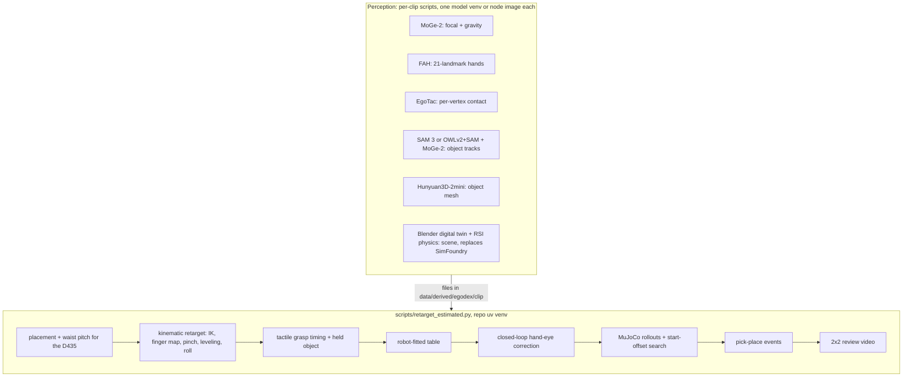

# System Architecture — Ego2Humanoid (as built)

The detailed, code-accurate design is `docs/TECH_DESIGN.md`. This file gives the shape of the
system and the invariants. The original v0.2 cloud-pipeline/SPIDER/OmniGibson architecture is archived
in `docs/archive/ARCHITECTURE_v0.2_plan.md`.

**Key invariant:** the only sensor input is one egocentric RGB MP4 (EgoDex [Hoque et al., 2025](REFERENCES.md#hoque2025egodex) in development). Acceptance requires an
action-controlled, contact-driven physics rollout, not a kinematic state replay.

## 1. Runtime shape



Everything runs on one GPU devbox: `scripts/run_pipeline.sh` drives the per-clip stages, either in
local venvs or (`DOCKER=1`) in one Docker image per stage (`nodes/{perception,hands,tactile,retarget}`,
`scripts/build_node.sh`, `scripts/node_python.sh`). There is no cloud job submission and no GitHub-dispatched run.
The `ego2humanoid` CLI, `src/orchestration/` and `nodes/{preflight,replay}`
remain for the contract/synthetic path; they are not used for real clips.

Source modules (`src/`): `common`, `contracts`, `egodex`, `robot`, `rsi`, `skills`, `evaluation`,
`orchestration`, `cli`, `synthetic`, and `stages/{reconstruction,retargeting,locomotion,manipulation,qa}`
(layout in `docs/TECH_DESIGN.md` §7).

## 2. Coordinate and physical conventions

- `T_A_B` maps points from frame B into frame A; 4×4 homogeneous, proper rotation.
- Camera frame: OpenCV (x right, y down, z forward). Simulation frame: z up, metres. The robot
  pelvis is welded at `T_sim_robot_base` (height 0.793 m) and does not move during a clip.
- `T_sim_camera` combines the MoGe-2 [[Wang et al., 2025b](REFERENCES.md#wang2025moge2)] gravity rotation with the anchoring chosen by the robot
  placement. Monocular depth is rescaled by the ratio of the FAH [[Cao, 2026](REFERENCES.md#cao2026fah)] and MoGe-2 wrist depths; nothing is claimed
  to be metric.
- Timing: source video at 30 Hz, robot control at 50 Hz, physics at 500 Hz.
- Joint arrays are in actuator order from `src/robot/layout.py` (43 for Dex3, 73 for Sharpa Wave).

## 3. Robot models

| Hand | Asset | Actuators | Notes |
|---|---|---|---|
| Dex3-1 [[Unitree Robotics](REFERENCES.md#unitree-g1)] | `assets/robots/g1_dex3/g1_29dof_with_hand_rev_1_0.xml` | 43 (29 + 2×7) | Three fingers; ring/pinky collapse onto the middle finger |
| Sharpa Wave [[Sharpa](REFERENCES.md#sharpa-wave); [Zakka et al., 2022](REFERENCES.md#zakka2022menagerie)] | `assets/robots/sharpa_wave/{left,right}_hand.xml`, attached by `src/robot/sharpa.py` | 73 (29 + 2×22) | Five fingers, compliant pads, tactile readout per region |

The same compiled MuJoCo [[Todorov et al., 2012](REFERENCES.md#todorov2012mujoco)] model is used for IK, collision checks, table fitting and replay. There
is no second engine, so no cross-engine parity check is needed.

## 4. Replay semantics and anti-cheating contract

1. Robot pose and object placement are set once, at reset.
2. Each control tick sends joint targets to PD position actuators. Nothing writes `qpos` or
   `qvel` afterwards; `StateInjectionGuard` checks this.
3. Contacts and friction move the object; its achieved pose is recorded.
4. `stages/manipulation/events.py` judges lift, carry, place and settle from the achieved states only.
5. Videos are rendered from the stepped simulation.

The start-offset search (25 candidate object positions within ±3 cm) refines the perceived
object position. Each candidate is a full action-controlled rollout, and the reported result is
the rollout that was actually simulated.

## 5. Artifacts

```text
data/derived/egodex/<clip>/          # <clip> = basic_pick_place_<id>; layout: data/README.md
  video.mp4  episode.json  gt/                      # export (gt/ for evaluation only)
  intrinsics_est.json  gravity_est.json             # MoGe-2
  hands_fah_f<focal>.npz  tactile_egotac.npz        # FAH, EgoTac
  objects_sam3.npz  object_crop.png  object_mesh_raw.glb  [physics.json]
  retarget_rgb{,_sharpa}.{json,npz}  sim_tactile{,_sharpa}.npz
  alignment/{alignment.json, contact_flags.npz, tactile_raw.npz}
  scene/{inventory.json, points.npz, mesh_*.glb}   # tabletop inventory (every clip)
  review/{result_grid*, sim_mujoco*, side_by_side*, trajectory*}  # RENDER=1
  real2sim_<hand>/{sim_bundle.{json,npz}, history.jsonl, iter_NNN/, accepted.yaml}  # Track RSI
/cloudfile/nvme_tmp/egodex/<clip>/panels/          # large render intermediates
<clip>/review/twin_scene_cam/                      # Blender digital-twin scene (camera frame)
data/scenes/egodex_104/                             # legacy SimFoundry scene (clip 104 only)
```

Failures are reported, not hidden: `retarget_rgb*.json` always carries `sim_events.success` and
`failure_reasons`.

## 6. Real2sim loop (Track RSI)

```text
real2sim_eval.py / real2sim_loop.py
  -> src/rsi (runner, robust, history, loop, answer, prompt)    simulator-free
       -> src/skills + skills/params (events, residuals, attribution, SimParams resolve)   simulator-free
       -> contracts/sim_backend.SimBackend  <-  rsi/backends/mujoco.py -> stages/manipulation
```

The only edge into a simulator is the `SimBackend` protocol; see `docs/TECH_DESIGN.md` §4.11.

## References

Works cited in this document; full entries in [`docs/REFERENCES.md`](REFERENCES.md).

- <span id="cite-cao2026fah"></span>[Cao, 2026](REFERENCES.md#cao2026fah). *Fast and Accurate Hand Estimation in Pixels, Interaction and World Space (FAH).*
- <span id="cite-hoque2025egodex"></span>[Hoque et al., 2025](REFERENCES.md#hoque2025egodex). *EgoDex: Learning Dexterous Manipulation from Large-Scale Egocentric Video.*
- <span id="cite-sharpa-wave"></span>[Sharpa](REFERENCES.md#sharpa-wave). *Wave tactile dexterous hand.*
- <span id="cite-todorov2012mujoco"></span>[Todorov et al., 2012](REFERENCES.md#todorov2012mujoco). *MuJoCo: A Physics Engine for Model-Based Control.*
- <span id="cite-unitree-g1"></span>[Unitree Robotics](REFERENCES.md#unitree-g1). *G1 humanoid robot and Dex3-1 dexterous hand.*
- <span id="cite-wang2025moge2"></span>[Wang et al., 2025b](REFERENCES.md#wang2025moge2). *MoGe-2: Accurate Monocular Geometry with Metric Scale and Sharp Details.*
- <span id="cite-zakka2022menagerie"></span>[Zakka et al., 2022](REFERENCES.md#zakka2022menagerie). *MuJoCo Menagerie.*
