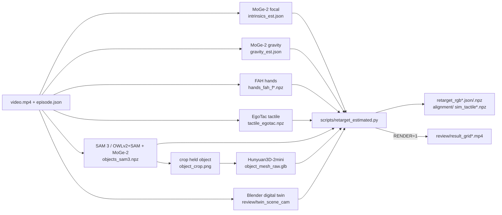

# Technical Design — Ego2Humanoid (as built)

> **Abstract.** Ego2Humanoid converts one egocentric RGB demonstration into an action-controlled humanoid rollout
> that is accepted only on physical evidence. This document specifies the pipeline exactly as implemented: its
> invariants (§1), data flow (§2), RGB-only perception (§3), kinematic retargeting with closed-loop correction
> (§4), review rendering (§5), the simulation model and acceptance criteria (§6), source layout (§7), testing (§8)
> and every deviation from the original plan (§9). Cited works are listed at the end.

**Status:** describes the pipeline as it is implemented in this repository. When code and this
file disagree, the code is right and this file is a bug. The original v0.3 plan (HOT3D oracle/
estimated MVP, SPIDER retargeting, cloud pipeline) is archived in
`docs/archive/TECH_DESIGN_v0.3_plan.md`; §9 lists every deviation from it.

**One-line summary:** one egocentric RGB clip (EgoDex [Hoque et al., 2025](REFERENCES.md#hoque2025egodex)) → RGB-only perception (MoGe-2, FAH,
SAM 3/OWLv2, EgoTac, Hunyuan3D) → kinematic retargeting onto a fixed-pelvis Unitree G1 with a
Dex3 or a Sharpa Wave hand, closed-loop on the robot's own pinch point → an action-controlled
MuJoCo rollout with a synthetic, robot-fitted table → independent pick-and-place QA → a 2×2
review video.

## 1. Scope and invariants

| Item | As built |
|---|---|
| Input | One RGB `video.mp4` per clip plus a task sentence (`episode.json`). Nothing else from the dataset is read by the pipeline. |
| Development data | EgoDex `basic_pick_place` [[Hoque et al., 2025](REFERENCES.md#hoque2025egodex)] (Apple, CC-BY-NC-ND). Test clips: 0, 1, 10, 100, 101, 104, 108, 114, 116, 117. |
| Ground truth | EgoDex ARKit hands/camera/intrinsics are exported to `<clip>/gt/` and used **only** for clip selection and evaluation (`scripts/eval_hands_vs_egodex.py`). |
| Robot | Unitree G1 [[Unitree Robotics](REFERENCES.md#unitree-g1)] 29-DoF body, pelvis fixed in the world; hands: **Dex3-1** (7 DoF/hand, 43 actuators) or **Sharpa Wave** [[Sharpa](REFERENCES.md#sharpa-wave)] (22 DoF/hand, 73 actuators, tactile pads). Selected with `HAND=dex3|sharpa`; Sharpa is the priority hand. |
| Physics | CPU MuJoCo [[Todorov et al., 2012](REFERENCES.md#todorov2012mujoco)] (`mujoco>=3.2`), PD position actuators, `dt = 2 ms`, implicit-fast integrator, elliptic friction cones [[Todorov, 2014](REFERENCES.md#todorov2014contacts)], `impratio = 10`. |
| Anti-cheat | After reset, the world advances only through `mj_step` under joint targets; `StateInjectionGuard` asserts object state is never written. Success is measured on achieved object states. |
| Claims | Results are physics-in-the-estimated-scene only; monocular depth/scale is not metric ground truth. |

## 2. End-to-end flow



`scripts/run_pipeline.sh <clip_id>...` drives all of it (stages `export, intrinsics, gravity, hands,
tactile, objects, scene, scene_mesh, held_mesh, retarget`; see `run_pipeline.md`).
Perception runs once per clip, file-to-file, each in the venv that carries its model (§7), or with
`DOCKER=1` in that stage's node image. The
robot part is a single script, `scripts/retarget_estimated.py <clip_dir>`, run under
`uv run --frozen --extra video --extra sim --extra hands --extra objects --extra egodex`.
It reads only the perception artefacts above and writes the report, the trajectory and (with
`RENDER=1`) the review videos.

## 3. Perception (RGB only)

| Step | Script | Model | Output | Notes |
|---|---|---|---|---|
| Fetch | `fetch_egodex.py` | — | `data/raw/egodex/` | Remote-zip range reads; `egodex/select.py` keeps single-active-hand pick-place clips (GT used for curation only). `egodex/export.py` writes `video.mp4`, `episode.json`, `gt/`. |
| Focal | `estimate_intrinsics_moge.py` | MoGe-2 [[Wang et al., 2025b](REFERENCES.md#wang2025moge2)] | `intrinsics_est.json` | Median focal over sampled frames; principal point at the image centre. |
| Gravity | `estimate_gravity_moge.py` | MoGe-2 normals | `gravity_est.json` | Up vector in the OpenCV camera frame = dominant horizontal-surface normal (RANSAC vote over the lower image half). |
| Hands | `estimate_hands_fah.py` | FAH (video mode) [[Cao, 2026](REFERENCES.md#cao2026fah)]; fallback WiLoR [[Potamias et al., 2025](REFERENCES.md#potamias2025wilor)] | `hands_fah_f<focal>.npz` | `joints3d (N,2,21,3)` [left,right], `valid`, scores; K from the MoGe focal, never the GT K. Backend selection: `configs/hands.yaml` → `stages/reconstruction/hands/backend.py::artefact_names`. |
| Tactile | `estimate_tactile_egotac.py` | EgoTac [[Zhang et al., 2026](REFERENCES.md#zhang2026egotac)] | `tactile_egotac.npz` | Per-MANO-vertex [[Romero et al., 2017](REFERENCES.md#romero2017mano)] `force`/`contact_prob (N,2,778)`. Enabled with `tactile.backend: egotac` or `E2H_TACTILE_BACKEND`. |
| Objects | `perceive_objects_sam3.py` (or `perceive_objects_owl.py` when SAM 3 is gated) | SAM 3 [[Carion et al., 2026](REFERENCES.md#carion2026sam3)] text prompt (or OWLv2 [[Minderer et al., 2023](REFERENCES.md#minderer2023owlv2)] boxes → SAM [[Kirillov et al., 2023](REFERENCES.md#kirillov2023sam)] masks) + MoGe-2 point map | `objects_sam3.npz` | Per-candidate camera-frame centroid and extent per sampled frame. Prompts come from the task sentence (`stages/reconstruction/objects/prompt.py`). |
| Mesh | `crop_object_sam3.py` → `generate_object_mesh.py` | SAM 3 mask; Hunyuan3D-2mini [[Hunyuan3D Team, 2025](REFERENCES.md#hunyuan2025hunyuan3d2)] | `object_crop.png`, `object_mesh_raw.glb` | Unit-scale shape, best of several seeds by silhouette IoU. Texture is baked later from the crop (`stages/reconstruction/objects/mesh_texture.py`). |
| Scene (Blender digital twin) | `build_twin_scene_cam.py` → `render_twin_cam.py` (bpy); assets via `twin_import.py` | MoGe-2 point map (scaled by `depth_scale`), table plane, fitted walls, FAH hands, authored/procedural assets, RSI-tuned physics (`docs/notes/track_bt_blender_twin.md`) | `review/twin_scene_cam/`, `review/twin_cam_bt.mp4` | **Replaces SimFoundry** [[NVIDIA GEAR, 2026](REFERENCES.md#simfoundry2026)] as the scene-reconstruction route (design decision of 2026-11-19): the twin is rebuilt in the video camera frame, so a render is directly comparable to the real video, and the same meshes become MuJoCo bodies (`stages/reconstruction/objects/twin_asset.py`). SimFoundry is legacy: clip 104 only, no new use. **Rendering rule (2026-11-20): Blender [[Blender, 2024](REFERENCES.md#blender)] is the only renderer** (`scripts/twin_render.py`: robot D435, third-person and human views, GPU Cycles); MuJoCo is headless physics and writes `sim_state.npz` v2. Production scheme: Hunyuan3D meshes + headless MuJoCo + Blender render (pipeline in §0 of the link doc); the LLM + RSI appearance loop (`twin_appearance_rsi.py`, `TwinAppearance`) is optional. See `docs/notes/track_bt_mujoco_blender_link.md` §7–8. |

Hand landmarks are cleaned in `stages/reconstruction/hands/smooth.py::clean_landmarks` (gap fill, outlier
rejection, smoothing) on frames with score > `MIN_SCORE` (0.7). The **active hand** is the one
whose wrist travels further; the other hand is retargeted too when it is valid in ≥ 50% of the
frames.

## 4. Retargeting and alignment (`scripts/retarget_estimated.py`)

The script runs the steps below in this order. Constants are named as in the code.

### 4.1 Camera → simulation frame and robot placement

* `stages/reconstruction/align/frames.py`: the camera frame is rotated so the MoGe up vector is +z; the motion is
  anchored to the table (`anchor_to_table`) rather than trusting monocular depth metrically.
* `stages/locomotion/base_placement.py::place_hand_motion`: the robot stands still for the whole clip (fixed
  pelvis at `PELVIS_HEIGHT_M` 0.793 m; there is no stepping). Its standing spot is chosen once,
  at initialisation, by a grid search over the hand-motion target `X_GRID_M` 0.20–0.50 m ×
  `Y_GRID_M` 0–0.25 m and a static waist pitch per spot. The score is the wrist IK error over a
  frame subsample (passive hand weight 0.2) plus an arm-collision penalty. Placements within
  `IK_SLACK_M` of the best compete on the camera score. A `PlaceGoal` (the corrected receptacle
  drop point, release frame) adds the place-phase reach to the score; see the three-pass retry in §4.7.
* `stages/reconstruction/align/camera_fit.py`: the head camera is the real Unitree D435 (torso-mounted, fixed
  intrinsics and mount pitch from `mjcf_scene.py`). It can only be re-aimed by pitching the waist
  (`waist_pitch_joint`, grid ±0.45 rad). The pitch is scored by projecting the robot pinch path
  through the D435 and comparing it with the human pinch's normalised image position in the
  source video: a coverage hinge (`SAFE_MARGIN` 0.10 from every border, weight 10) plus a layout
  term (weight 1). No virtual camera is used. Intrinsics: the D435 colour sensor's native 16:9 mode,
  69.4° × 42.5°, rendered at `mjcf_scene.D435_IMAGE_HW` = 360 × 640 (the fit uses the same aspect).
  A 4:3 render would crop it to 54.8° horizontally. Even at 16:9 the robot view is about 1.9× more
  zoomed than the human camera (EgoDex GT focal 736.6 px at 1920 × 1080, ≈105° horizontal): a hardware
  gap, since the hand–camera distance is similar (≈0.43 m).

### 4.2 Kinematic retargeting (`stages/retargeting/kinematic.py`, `clip.py`)

* **Wrist:** damped least-squares IK [[Wampler, 1986](REFERENCES.md#wampler1986dls); [Nakamura and Hanafusa, 1986](REFERENCES.md#nakamura1986dls)] on the arm (`robot/kinematics.py::ArmIK`) to the human
  wrist frame (`hand_frame`), warm-started from the previous frame and restarted from the
  neutral arm when it misses by more than `RESTART_POS_ERR_M` (1 cm).
* **Fingers:** human finger curls from landmark bend angles (`finger_curls`) mapped by
  `robot/finger_map.py`: Dex3 collapses ring/pinky onto the middle finger; Sharpa maps one robot
  finger per human finger. While a Sharpa hand pinches, middle/ring/pinky tuck
  (`PINCH_TUCK_CURL` 0.9).
* **Pinch gap:** when a commanded gap is given, `robot/pinch.py` (`PinchSolver` for Dex3,
  `SharpaPinchSolver` with fingertip sites for Sharpa) sets the thumb/index joints to reach it,
  with a lean penalty that keeps the distal links upright.
* **Pinch leveling:** during the pinch the thumb–index axis is turned level over
  `LEVEL_RAMP_FRAMES` (10). The turn share falls back through `TURN_FALLBACK_FRACS`
  (1, 0.5, 0.25, 0) when unreachable and is rate-limited to `TURN_FRAC_RATE` (0.05/frame)
  in a two-pass solve, so the share never jumps. The leveling IK is seeded from the previous
  frame's arm. After a pinch run ends, the leveling shift and turn fade back to the human wrist
  over the same 10 frames (no step at the release).
* **Arm collisions:** `_avoid_arm_collisions` lifts/moves the passive wrist away from the active
  arm and the torso (`AVOID_STEP_M` 2 cm, up to `MAX_AVOID_ITERS` 16).
* **Table clearance loop** (up to `MAX_CLEARANCE_ITERS` 3 rounds): measure robot-table
  penetration of the executed geometry (`stages/reconstruction/align/table_fit.py::table_penetration`). An offending
  hand outside the grip window is lifted (`clearance_lift`). Inside a grip run, palm or deep
  finger contact (> `FINGER_ROLL_TOL_M` 1 cm) rolls the pinch about its axis
  (depth / `ROLL_LEVER_M` 6 cm, ≤ `MAX_PINCH_ROLL_RAD` 60°). A grip run keeps its roll only if
  the summed hand penetration did not grow; otherwise it is reverted, frozen and re-solved
  (`_worse_roll_runs`).
* The joint targets are resampled to `CONTROL_RATE_HZ` 50 Hz.

### 4.3 Held object, grasp timing and tactile alignment

* **Proxy rollout:** a first retarget is replayed with a proxy box sized from the hand
  (`stages/reconstruction/objects/grasp_proxy.py`, tagged `grasp_proxy`, never accepted as perception).
* **Held object:** perceived candidates are scaled into the hand's depth with
  `stages/reconstruction/objects/fuse.py::hand_depth_scale` (median FAH/MoGe depth ratio at the wrist pixel) and
  `select_held_object` follows the candidate nearest the pinch. Its hold window starts
  `CLOSE_LEAD_FRAMES` (12) before the object is first seen lifted.
* **Tactile timing (EgoTac):** `stages/retargeting/tactile_grasp.py` smooths the thumb/index pad contact
  probability (`CONTACT_PROB` 0.25), splits it into contact spans and picks the span that
  contains the pinch rise of at least `MIN_PICK_RISE_M` 5 cm (`pick_span`). The grip moves to
  that span's onset (`grasp_onset`). This handles touch-slide-then-lift clips (clip 1). Without
  tactile, the grip moves to the last frame where the human pinch was within
  `GRIP_REACH_TOL_M` 3 cm of the object.
* The simulated pad readout (`stages/manipulation/sim_tactile.py::SimTactile`, EgoTac region schema) is
  recorded on the render rollout. `support_touch` uses it to report when the active hand presses
  the table. The human tactile npz is copied to `alignment/tactile_raw.npz`.
  `stages/retargeting/tactile_target.py` provides the human→robot region mapping and a sim-vs-target
  comparison.

### 4.4 Object asset

* `stages/reconstruction/objects/mesh_asset.py::build_mesh_asset`: the Hunyuan3D mesh rests on its most stable face.
  It is scaled to the perceived extent, yawed so its narrow side faces the robot pinch axis, and
  textured from the crop. Without a mesh the object is a box.
* Antipodal pinch (`mesh_asset.py::antipodal_axis_xy`): the narrowest chord of a rounded or
  tapered footprint ends on faces that lean towards each other (wedge angle α), and the squeeze
  pushes the object out of the grip. Chords through the footprint centre within ±45° of the pinch
  axis, no more than `ANTIPODAL_EXTRA_WIDTH_M` (1 cm) wider than the narrowest, are scored by
  tan α of their end edges + 0.1 per radian of turn. The object is yawed so the best one lies on
  the pinch axis; its tan α feeds the grip sizing (§4.5).
* Thin objects are extruded to `MIN_OBJECT_THICKNESS_M` (4 cm), capped at
  `MAX_EXTRUDE_ASPECT` × the pinched width for Sharpa (2×). Every held mesh collides as a
  straight prism over its footprint (`prism_hull`, vertical walls: MoGe only sees the top, so
  the hull tapers), or as a parallel slab (`slab_prism`) when extruded and narrower than
  `SLAB_MAX_WIDTH_M` 2.5 cm.
* Mass/friction: `physics.json` when present (VLM contract of SimFoundry stage 11,
  `physics_params.parse_physics_json`), else `heuristic_physics` (category keyword → density).
  The mass is floored at `physics_params.MIN_MASS_KG` (30 g): a 10 g estimate is thrown by any
  contact spring or wrist jerk (clip 114).
* After the final trajectory is known, the object is re-yawed to the commanded pinch axis when it
  differs by more than `PINCH_AXIS_TOL_DEG` (10°), measured over `GRASP_AXIS_FRAMES` (15)
  open frames before the close.

### 4.5 Pinch gap schedule

The fingers are PD position servos, so the grip force is their stiffness times the squeeze (how far
the commanded gap is closed past the object). `stages/retargeting/grip.py` sizes the squeeze per clip:

* required force per contact `N = SF·m·(g + a) / (2(μ − tan α))`, with `SAFETY_FACTOR` 2,
  `a = CARRY_ACCEL_M_S2` (3 m/s², env `E2H_CARRY_ACCEL`), μ the object friction (≥ 1, §6),
  tan α from the antipodal search (capped at 0.7), floored at `GRIP_MIN_N` (4 N, env `E2H_GRIP_N`);
* series pinch stiffness `K = 1 / (nᵀ (J_t − J_i) Kp⁻¹ (J_t − J_i)ᵀ n)` at the mid-hold pose with
  the fingers solved to the gap (`hold_pinch_stiffness`; the arm columns cancel in `J_t − J_i`).
  Measured: Sharpa 180–260 N/m, Dex3 1400–2700 N/m;
* squeeze = `N / K + CONTACT_ALLOWANCE_M` (2 mm), clipped to [`SQUEEZE_M` 1.2 cm (env
  `E2H_SQUEEZE`), `MAX_SQUEEZE_M` 2 cm]. The joint force limits are not the bottleneck (Sharpa
  20–36 N available at the tip), the stiffness is.

The closed gap is the object width at the pinch minus that squeeze. The open gap is
`max(width, open_width) + OPEN_MARGIN_M (2 cm) + OPEN_PAD_M[hand]` (Sharpa 1.5 cm, the pad
radius), where `open_width` is the footprint span along the pinch axis capped at
width + `MAX_OPEN_EXTRA_M` (4 cm). It is held over the `APPROACH_FRAMES` (30) before the grip. The pinch then closes over
`CLOSE_RAMP_FRAMES` (6). After the release it opens back to the open gap over
`RELEASE_OPEN_FRAMES` (6, env `E2H_RELEASE_OPEN`) and stays open through the dwell, retreat and
blend of the release primitive (§4.7); only then is it left to the human finger curl. (Left to the
curl right away, the Sharpa fingers stayed 0.7–0.9 closed and the object stuck to a pad.) The
approach-to-blend-end span is the clearance-exempt window (the active fingers may touch the table
there).

### 4.6 Synthetic table, fitted to the robot

The simulated table does not copy the video; it only has to carry the object where the robot can
grip it with both arms starting clear of it.

* `stages/reconstruction/align/table_fit.py::fit_table_height` searches table tops `TABLE_Z_GRID_M` 0.70–0.86 m
  (below the G1 elbow). It scores IK error, robot-table penetration (weight 3) and a mild
  preference for the height the video suggests. The whole hand motion shifts vertically with the
  table, and a thin object may be stretched down to the lower top (`OBJECT_EXTEND_GRID_M`).
* `stages/retargeting/support_clearance.py::lift_above_support` lifts landmarks that sit below the table top
  (+ `CLEARANCE_M` 1.5 cm), except in the exempt window. Every other object the robot collides
  with (receptacle, scene objects) is a support too, over its xy box + `OBSTACLE_MARGIN_M` (2 cm):
  the idle hand of clip 104 otherwise rested 2.7 cm inside the welded bowl's wall for the whole
  clip, and the jammed contacts lost the other hand's grasp. A body with collision pieces gives one
  support per piece (`_object_supports`): a single top over clip 101's open case held the hand as
  high as its 14 cm lid, and the tape could never be lowered into the 4 cm base. Only the active
  hand gets the pieces; the other hand never reaches into a container and keeps one support over
  each object's whole extent (`retarget_clip(passive_obstacles=...)`). With pieces it rested its
  fingers against clip 104's bowl rim again, and the reaction twisted the waist 0.14 rad and the
  active hand 7 cm off the block (NO_LIFT). The torso-avoidance push (`_avoid_arm_collisions`, up
  to `MAX_AVOID_M`) moves the idle wrist forward and outward after that clearance, so the pushed
  landmarks are lifted above the same supports again and the rise is added to the wrist offset.
* The table spans the hands' reach plus `TABLE_MARGIN_M` (0.30 m). The carried pinch is clamped
  `TABLE_INSET_M` (5 cm) inside its rim. `near_edge_clearance` then moves the near edge forward
  until no arm link, torso or leg is within `BODY_CLEARANCE_M` (2 cm), but never past the object,
  the receptacle or the held pinch path (`TABLE_NEAR_EDGE_M` ≥ 0.10 m from the pelvis).

### 4.7 Closed-loop hand-eye correction (`stages/retargeting/hand_eye.py`)

The robot hand is not human-sized, so its pinch point misses the object by a time-varying error.

1. `anchor` = the object's rest xy at the grip height; `tip_cap` keeps the tips above the table
   by `PAD_REACH_M` / `TIP_FLOOR_M`.
2. `phase_windows` / `blend_corrections`: the correction is expressed in the grasp object's frame
   until the close. It is then handed over to the receptacle's frame over `PLACE_LEAD_FRAMES`
   (20) before the release, with an xy lead of `PLACE_XY_LEAD_FRAMES` (25) and a
   `PLACE_DWELL_FRAMES` (15) hold after it. The xy lead never starts before the fingers have
   closed (`close_start + CLOSE_LEAD_FRAMES`): on a short carry (clip 0) it otherwise pulled the
   open hand 3.5 cm off the object. The receptacle comes from the scene `objects.json`
   or the stationary detection nearest the release pinch (`stages/reconstruction/objects/place_target.py`), and is
   re-anchored onto the synthetic table (`rebase`). A hollow receptacle (bowl) collides as a
   conical tub (`container_pieces`), so objects can drop into it. See
   `docs/notes/target_frame_switching.md`.
   Every clip has this place phase. For a bare-table transfer the "drop point" is the human
   pinch at the release with the carry's xy offset, at the grip height + `BARE_PLACE_LIFT_M`
   (3 mm), so the object is put down instead of dropped from the height the human let go at.
3. `limit_carry_acceleration`: between `close_start + CLOSE_LEAD_FRAMES` and the release the held
   path is Gaussian-smoothed (σ 1…8 frames, faded in/out over 6 frames so the grasp and release
   points are kept) until its peak acceleration is ≤ `CARRY_ACCEL_M_S2`. A jerk of the human
   path (clip 114: one frame at 30 m/s²) otherwise loads the soft grip sideways and throws the
   object.
4. `release_motion`: after the last closed frame the pinch holds still for `PLACE_DWELL_FRAMES`
   (15) while the fingers open, rises `RETREAT_HEIGHT_M` (4 cm, env `E2H_RETREAT_M`) straight up
   over `RETREAT_FRAMES` (8), then blends back onto the human path over `RETREAT_BLEND_FRAMES`
   (10). Its weight joins the phase and approach windows in `align_pinch`.
5. `settle_approach`: the open pinch hovers `HOVER_CLEARANCE_M` above the object (≤
   `MAX_HOVER_RISE_M`) and comes straight down over `SETTLE_FRAMES` before closing. Before that,
   from the fingers closing to the start of the place window, the held object's box is raised over
   every other object's collision piece it would pass through (`held_object_lift`,
   `HELD_CLEARANCE_M` 5 mm; pieces already under it at the grasp are skipped; the smoothed lift is
   zero before the fingers close, so it never raises the open hand). The pieces are grown
   by `HELD_MARGIN_M` (2 cm): the executed pinch lags the commanded one near the arm's reach
   (117: 3 cm, so a 3 mm margin still met the rim). The hand lift above
   obstacles is exempt at the grasp, so nothing kept the carried object out of them (clip 117: the
   block swept through the scooper's rim 1 cm under its top and was knocked out of the pinch).
   The place window is left alone: its drop point is already clear of the receptacle (lifting
   there released clip 10's block 8 cm above the scoop).
6. `align_pinch`: iterate IK → robot pinch point (forward kinematics) → offset to the target
   (≤ `MAX_OFFSET_M`, `MAX_ITERS` 4, `PINCH_TOL_M` 5 mm).
7. If more than 5% of frames end with IK error > 3 cm, the correction is backed off until it
   stays reachable. The place alignment is dropped first (grasp, place fractions (1, 1), (1, 0.75),
   (1, 0.5), (1, 0.25), (1, 0)), then both together (0.75 … 0): a far receptacle must not cost the
   grasp. When the full correction fails, the grasp-only path (1, 0) is solved once and the bound
   becomes its unreachable fraction + 1 %, so the place correction is judged by the frames it
   adds rather than by what the grasp correction already took out of reach: a clip that leaves the workspace anyway (117: 19 % uncorrected) keeps the
   corrections that cost no further frames instead of falling through all seven to none (the hand
   then released on the scooper's handle, after 67 min of retargeting). The log line
   `path correction: grasp X, place Y` records the choice, the next line each try's fraction.
   **Place-aware placement retry (three passes):** when the chosen place fraction is < 1 (the
   receptacle's drop point is out of reach from a standing spot chosen on the human path alone;
   clips 114, 116), the script re-executes itself through `E2H_PLACE_GOAL`. Pass 1: unset, placement
   on the human path (the result is cached in `<clip>/.placement_first`). Pass 2: a JSON `PlaceGoal`
   (corrected drop point, place keyframe, release frame) makes `place_hand_motion` score the standing spot
   on the corrected path. Pass 3: `off`, only when pass 2 still did not reach the full place
   correction; it restores pass 1's cached placement. `E2H_RETARGET_CACHE` points at that cache.

### 4.8 Rollouts and start-offset search

* The final trajectory is replayed once, recording tracking error, table penetration and the
  torso-contact fraction (`robot/collision.py::ArmCollisionChecker`).
* Perceived depth is good to a few cm only, so the object's start xy is refined by physics. The
  no-offset start plus a 5×5 grid of offsets within ±`START_SEARCH_M` (3 cm), 25 distinct starts
  (`stages/manipulation/sim_eval.py::offset_grid`), is tried, one rollout each, scored by
  `(success, lift_height)` from `stages/manipulation/events.py::detect_pick_place`, with the per-frame
  robot-object contact and the planned release time (§6 QA). The best start wins.
  `expected_translation_m` is the demonstrated carry, so a short demo carry is judged against
  `translate_demo_frac` (0.75) of itself instead of the fixed 10 cm.
* Adaptive settle (`stages/manipulation/rollout.py::run_rollout`): after the last target the rollout
  runs `settle_tail_s` (0.5 s) more and then up to `settle_max_s` (1.5 s) further, until every object
  has been at rest for the settle window, so an object still tumbling at the end is not scored `NOT_SETTLED`.
* There are no randomised seeds/perturbations in this script; `stages/manipulation/rollout.py` supports
  `Perturbation` and `stages/manipulation/engine.py` the seeded multi-rollout `SimRunBundle` path used by the
  stage CLI and tests (the RSI `robust` gate also uses perturbed seeds, §4.11).

### 4.9 Outputs

| File | Content |
|---|---|
| `retarget_rgb{,_sharpa}.json` | Report: placement, waist pitch, camera coverage, IK errors, unreachable fraction, table fit and penetration, grasp timing, `sim_events` (success, lift, carry, failure reasons), tracking error, proxy summary. |
| `retarget_rgb{,_sharpa}.npz` | `timestamps_s`, `q_target_rad (M, 43 or 73)` in actuator order. |
| `alignment/` | `alignment.json` (`T_sim_camera`, `table_top_z_m`, depth `scale`), `contact_flags.npz`, `tactile_raw.npz`. |
| `sim_tactile{,_sharpa}.npz` | Simulated per-region pad force/contact (render runs). |
| `review/` | See §5. |

`E2H_DUMP=<file>` additionally pickles the final scene inputs for offline debugging.

### 4.10 Tabletop scene objects (`stages/reconstruction/scene/inventory.py`)

Every object on the table is simulated, not only the held object and the receptacle, so the
robot meets the same clutter and the same container interactions as the human. This holds even when
`SCENE_DIR` is set (`run_pipeline.sh` sets it for clip 104): when a clip has an inventory, the script drops
`SCENE_DIR` so the reconstructed scene does not duplicate the inventory objects.

1. **Perception** (`scripts/perceive_scene_objects.py`, perception venv): OWLv2 (generic tabletop
   vocabulary + the task's held/place/source phrases) → SAM → MoGe-2 points on keyframes from the
   first seconds, before the hand arrives. An object must be seen in half of the keyframes. Writes
   `<clip>/scene/` (`inventory.json` with the median mask colour, `points.npz`, crops,
   `inventory.jpg`). `generate_object_mesh.py <clip> --scene` meshes every crop (Hunyuan3D).
2. **Frame**: the depth scale is carried over from `objects_sam3.npz` by the median depth ratio;
   the layout is translated rigidly so the inventory's copy of the held object sits where the
   pipeline grips it (≤ `scene.max_registration_m`, default 15 cm), then so the grip lies on the source's inner
   floor (step 4). When the held object or source was found but every offset exceeds the limit
   (monocular depth stretch, clip 108), the layout is not simulated (`report.unregistered`): its
   items would stand in the human hand's path, so the pipeline keeps its own held object and
   place target. Roles live in `stages/reconstruction/scene/roles.py`; `scene.source_from`
   (`grip` default / `name`) chooses whether the object under the grip or the task's source name wins
   (clip 108: swapped detector names), and the `scene_layout` skill flags role swaps, far rebases
   and large grip gaps with hints naming these knobs.
3. **Shape**: the mesh rests on its stable face, is scaled to the footprint (min-area rectangle of
   the points on the table) and height, and yawed to the footprint. The mesh is aligned by its own
   min-area rectangle, not its principal axis, so its sides coincide with the footprint's and with
   the tray walls built from it (a near-square lid's principal axis was 12° off its sides, and the
   collision walls cut through the visual lid). The footprint fixes the yaw only up to a half
   turn (a quarter turn when mesh and footprint are near-square, `SQUARE_ASPECT`): `orient_quarter`
   keeps the turn whose surface is closest to the object's observed points (clip 101: the open
   case's lid stood at the front, over the base the tape goes into). An open container mesh
   (`heightmap_open`: ≥ `HMAP_OPEN_FRAC` of its cells below half its height) that is not a bowl-like
   `TUB_WORDS` item is its own collision: a heightmap of its top surface (`HMAP_CELL_M` 1.5 cm
   cells), one box per run of similar columns (`_heightmap_pieces`), with the floor at the median
   of its low cells. The runs are merged into the heightmap itself (`_merge_rows`), so the floor,
   sinking and drop height are read from the collision boxes (clip 114: the tray floor was 5 mm
   under its boxes and the block spawned inside them was thrown up). A source container is sunk
   so that the surface under the held object's footprint, at most `HMAP_MERGE_M` above the floor,
   is the table. Objects standing inside such a container are moved to the nearest spot where the
   surface under them is its floor (`HeightMap.free_spot`, at most one cell away; further in they
   would take the room the held object is put into) and rest on the surface under them: the footprint
   clamp of a synthesised tray does not know the mesh's walls (clip 0: the cube spawned inside the
   half-turned box's wall and was thrown 26 cm). Tray walls misrepresent anything that is not a tray (clip 101: 14 cm walls
   all round a case with a 4 cm base; clip 117: a tub over the scoop's handle). Its drop point is
   the spot nearest the release whose surface under the held box is within `DROP_SURFACE_TOL_M` of
   the lowest, at that surface's height (`drop_z`). Otherwise, containers are hollow when the
   points dip inside the rim (`HOLLOW_*`); only items whose label is a container can be hollow (a
   table's legs also show the floor). Trays get thin walls, round containers a tub
   (`container_pieces`): `TUB_BANDS` (3) rings of wedges whose inner radius follows the mesh's
   inner wall (`tub_profile`: a low percentile of the vertex radius per height band, never
   narrower than the default 0.6→0.82 cone, so a closed mesh forced hollow keeps its opening). A
   fixed 0.82 rim left a 1.6 cm collision ledge inside a bowl whose visual rim is at 0.91, and the
   object came to rest on it (clip 116, scored a success 7 cm up). The drop point
   (`SceneInventory.drop_xy`) follows the same collision geometry: inside a tray, the rectangle
   within its walls; inside a tub, an ellipse of the profile at the held box's mid-height, which
   the box's corners must stay inside. A rectangle-room
   drop point in a bowl sat over the sloped wall or rim and the object bounced out (clip 116: 6.6 cm
   off-centre over a 5 cm-radius floor). `separate()` pushes overlapping footprints apart; nothing may overlap the
   held object's box (`HELD_KEEPOUT_M`), and the receptacle is never treated as stacked on that box
   (`never_stacked`), so it cannot sit under the grip.
4. **Roles** from the task text (`objects/prompt.py`):
   * *held*: the inventory copy is replaced by the pipeline's grasp object. Without a name match,
     the nearest object within `HELD_MATCH_M` is used; if the task names the object (so it was
     simply not detected), only within `HELD_FALLBACK_M` (4 cm) of the grip, and never a container
     around the grip `HELD_MAX_AREA_RATIO` (4×) larger than the held box: clip 117's "silver tray",
     detected as "tupperware", became the held block and vanished; now it is the source.
   * *receptacle*: handed to the place-target resolver; objects inside it move with it. A generic
     task ("place it somewhere else") takes the container the human pinch stays over for ≥
     `RELEASE_MIN_FRAMES` (5) in the second half of the hold, not the one it starts in
     (`report.receptacle_from: carry`); the detected release can come late (clip 101), so the
     pipeline keeps such a receptacle in place instead of re-anchoring it on the release. A named
     container the geometry calls solid (a scoop whose handle fills the footprint) is forced
     hollow with its floor at `RECEPTACLE_FLOOR_FRAC` (25%) of its height (`hollow_from: task`).
   * *source* ("from the blue bowl"): welded and sunk so its floor is the table, and exempt from
     robot contact (`BoxObject.robot_collision=False` → contype/conaffinity 2/2 vs objects 3/3 and
     robot 1/1). The fingers otherwise land on its rim. Accepted artefact: they visibly clip the
     rim. The layout is always shifted so the grip lies on its inner floor (`SOURCE_INNER_FRAC` of
     the footprint minus the held half size): the held object may be hidden inside it (clip 10) or
     matched with a bad offset that would start it on the wall (clip 114).
   * everything else: a free body with `heuristic_physics` mass/friction.
5. **Colour override**: OWL confuses categories (clip 10: the yellow bottle as "scoop"). When the
   phrase's head noun hits an item whose hue contradicts the task colour by > `COLOUR_SWAP_HUE_DEG`
   (70°), and exactly one item has the named hue (saturation ≥ 0.3, area ≥ 0.5× the hit), the phrase
   moves to that item and it is relabelled (`report.relabelled`). Only hue words count: the beige
   table tint makes many items read "orange".
6. **QA**: free objects that move > `DISTURBED_M` (3 cm) in the rollout are reported as
   `disturbed`. `E2H_SCENE_OBJECTS=0` falls back to the held object and receptacle only.

### 4.11 Parameter-tunable real2sim loop (Track RSI, `rsi`, `skills/params`, `skills`)

Every physics and plan constant of `retarget_estimated.py` is a leaf of the `SimParams` contract
(`contracts/sim_params.py`, `configs/sim_params/default.yaml`; unit, range, `affects` = `sim` or
`sim+plan`). Resolution order: model defaults → the clip's `real2sim_<hand>/accepted.yaml` →
`$E2H_SIM_PARAMS` → legacy `E2H_*` variables → `--set` pairs. A full run writes the *sim bundle*
(`real2sim_<hand>/sim_bundle.{json,npz}`, no pickle): the frozen plan, the references and the
parameters, enough to replay the trajectory without perception.

One iteration (`rsi/runner.py::evaluate`) picks the cheapest tier: **rollout** (seconds)
for `sim`-only changes, **full** (20–40 min, re-plans) when a `sim+plan` key changed
(`--freeze-plan` forces rollout and ignores plan effects). The rollout is judged by
simulator-independent code in `skills`: event detectors (contact, lift, slip, drop, grasp
penetration, start-embedded, place-buried), residuals against the video references, the final-pose
check, and a rule table that maps events to parameter hints. The result is `feedback.md` +
`feedback.json` per `iter_NNN/` and one row in `history.jsonl`.

* **Mode A**: an agent (or person) drives `scripts/real2sim_eval.py init|eval|history|show|robust|accept`
  (playbook `docs/notes/agentic_real2sim.md`).
* **Mode B**: `scripts/real2sim_loop.py` runs the same evaluation, submits a `real2sim_params` request
  to the Copilot relay (exit 75 while unanswered), validates the answer (`answer.py`: known paths, ≤ 3
  changes, no repeat) and continues until `SUCCESS`, `PATIENCE`, `MAX_ITERS`, `AGENT_STOP` or
  `AGENT_ERROR`.
* **Gate**: `robust` replays the iteration over the 25-point start grid and 5 perturbed seeds
  (start ±5 mm, friction/mass ±20 %). It passes with ≥ 3/5 seed successes (the grid fraction is
  reported only: the open-loop plan is not re-aimed per start). `accept` copies `params.yaml` to
  `accepted.yaml` and is refused without a passing `robust.json`; later full/batch runs pick the file
  up automatically.

**Simulator decoupling.** The loop talks only to `contracts/sim_backend.SimBackend`
(`load`, `plan`, `rollout`, `search_start`, `start_grid`) and exchanges neutral data
(`ClipReference`, `RolloutRecord` of plain arrays). `rsi/backends/mujoco.py` is the only
real2sim module that imports `stages/manipulation`; `tests/unit/test_real2sim_backend.py` enforces that
`rsi`, `skills` (except the `traj_panel` render panel) and `skills/params/resolve.py` import no
simulator. To switch simulator: implement the protocol, register a factory in
`rsi/backends/__init__.py`, select it with `--backend` or `$E2H_SIM_BACKEND`, and map the
`sim` leaves of `SimParams` (the contact/PD leaves are MuJoCo vocabulary today: `solref`, `impratio`,
`cone`, ...) onto the new engine or ignore those the engine lacks. The `RolloutRecord` array
conventions are in the module docstring. The full-pipeline script is still MuJoCo-specific; a backend's
`plan` may call any other planner as long as it writes a bundle the backend can `load`.

## 5. Review rendering (`RENDER=1`)

Before rendering, `stages/qa/review_paths.py::clean_review` deletes every artefact of this hand that
the run is about to rewrite. Small deliverables stay in `<clip>/review/`. Large intermediates
(`ego_d435*.npz`, per-panel `tl/tr/br*.mp4`) go to `/cloudfile/nvme_tmp/egodex/<clip>/panels`
(override `E2H_BULK_DIR`).

`review/result_grid{,_sharpa}.mp4` (`stages/qa/grid_video.py`), panel order fixed:

| Panel | Content |
|---|---|
| top-left | source RGB with both estimated hand skeletons, painted with the simulated pad forces. The human EgoTac regions are shown instead only if `alignment/tactile_regions.npz` exists (`stages/reconstruction/hands/tactile.py::write_tactile_regions`); `retarget_estimated.py` does not write it |
| top-right | the robot executing the clip in MuJoCo, free 3/4 camera, receptacle included |
| bottom-left | the robot's own head D435 view of the **simulated** scene (table, room, objects), `EgoNeuralRecorder(camera="d435", size=D435_IMAGE_HW, drop_background=False)` (360 × 640, letterboxed in the cell); no Gaussian-splat background |
| bottom-right | task-space trajectories (wrist, fingertips, object, camera), isometric (`stages/qa/traj_panel.py`) |

Also written: `sim_mujoco*.mp4`, `side_by_side*.mp4`, `trajectory*.npz`. With a scene,
`ego_plate_composite*.mp4` (the human camera over the clean plate) is written as reference only.
The splat code (`stages/reconstruction/scene/bg_splat.py`, `scripts/build_bg_splat.py`, `render_bg_splat.py`,
`make_review_grid.py`) is kept but not used by the default render.

## 6. Simulation model

* `stages/manipulation/mjcf_scene.py::build_scene`: the vendored G1 MJCF (`assets/robots/g1_dex3`, pelvis
  welded at `T_sim_robot_base`). For Sharpa, `robot/sharpa.py::attach_sharpa_hands` replaces the
  Dex3 subtrees with the Sharpa Wave MJCFs (`assets/robots/sharpa_wave`). Then the box table,
  the object (mesh convex hull or explicit convex pieces) and welded receptacles are added, plus
  the D435 camera on `torso_link`.
* PD position actuators per joint group (`PDConfig`): hand kp 8, wrist 40, shoulder/elbow 150,
  waist/legs 300; gravity compensation on the fixed-pelvis robot. The Sharpa wrist gains are
  scaled 2.5× (`HEAVY_HAND_WRIST_SCALE`).
* `stages/manipulation/rollout.py::run_rollout`: sets the initial robot pose and object placement once, then
  linearly interpolates `q_target` (`stages/manipulation/controller.py`) and steps physics. It also records
  `object_robot_contact (N, n_obj)`: whether any robot geom touches each object.
* Object contact model (`SceneConfig.object_contact`, `ObjectContact`). Every object geom has
  `priority` 1, so in a robot/table–object pair MuJoCo takes the object's parameters verbatim
  instead of mixing them: `condim` 4 (adds torsional friction, `torsion_m` 1 cm, so a two-point
  pinch does not let the object spin about the pinch axis), `solref` (0.01, 1.0) and `solimp`
  (0.95, 0.99, 1 mm) — stiffer than the Sharpa pad default (0.06, 0.9) that let the tips sink
  4.5–6.5 mm in and store energy that later threw the object — and sliding friction
  `max(object μ, min_slide_friction 1.0)`, the old max-mixing result. `noslip_iterations` 5
  removes the creep that soft friction allows inside the cone. `object_contact=None` restores
  the legacy mixing (used by `scripts/preview_object_mesh.py`).
* Actuator indexing goes through `robot/layout.py::RobotLayout`, so Dex3 (43) and Sharpa (73)
  share all code.

**QA** (`stages/manipulation/events.py`, pure numpy, on achieved object poses): success = lift ≥ 5 cm, carry ≥
min(10 cm, 0.75 × demo carry), final height within 2 cm of the rest height (or within 8 cm of
the receptacle drop point), and at rest (speed < 5 cm/s, angular < 0.5 rad/s for 0.3 s). With
`hand_contact` and `release_t_s` (as the retarget script passes them) the hand must also have
done it, otherwise a thrown object that lands well counts:

| Reason | Condition |
|---|---|
| `EJECTED` | ≥ 2 consecutive frames airborne (> `airborne_m` 2 cm over rest), untouched and moving > `eject_speed_m_s` 0.4 m/s horizontally |
| `DROPPED_IN_CARRY` | an untouched gap > `carry_drop_s` 0.1 s between the lift and `release_lead_s` 0.2 s before the planned release |
| `AIRBORNE_RELEASE` | at the last touch the object is > `release_height_m` 3 cm above where it ends |
| `STUCK_AFTER_RELEASE` | still touched > `release_grace_s` 0.6 s after the planned release |

**Copilot relay** (`stages/reconstruction/scene/vlm_relay.py`, `scene/simfoundry_runner.py`): pipeline code never calls
external APIs. SimFoundry's Gemini client is replaced by `RelayClient`, which writes request
bundles to `relay/outbox/` and exits with code 75. A Copilot session answers into
`relay/inbox/`, and the stage is re-run. Image edits use local FLUX.1-Kontext. Used only for the
optional scene reconstruction.

## 7. Source layout and environments

```text
src/
  contracts/      Pydantic bundles, enums, NPZ array specs (v1.2)
  common/         io, hashing, transforms, video helpers
  synthetic/      deterministic generators for smoke tests
  egodex/         clip_reader, export, select (GT for curation/eval only)
  robot/          asset probe, layout, kinematics (ArmIK), collision, pinch, finger_map, sharpa, floating_hand
  stages/
    reconstruction/  hands, objects, scene, align (camera/table fit, ego VO, frames)
    retargeting/     kinematic, clip, hand_eye, grip, grip_timing, support_clearance, tactile_*, contact,
                     held_mesh, script_helpers, script_params, spider_convert
    locomotion/      base_placement, route, stance_adjust, tabletop, executor, clip_task, plan/
    manipulation/    mjcf_scene, rollout, engine, controller, guard, sim_tactile, render, events, checks,
                     sim_eval, probes, scripted
    adapters.py      stub adapters of the contract/synthetic path
    qa/              review rendering helpers (grid_video, traj_panel, hand_overlay, review_paths)
  rsi/            Track RSI loop: runner, robust, history, loop, answer, prompt, backends/ (SimBackend impls)
  skills/         RSI skill library: feedback, attribution, residuals, final_pose, place_check,
                  reachability_check, real2sim_report, physics_fidelity, params/ (SimParams resolve,
                  scene overrides); library.py = registry of the skills (docs/notes/skills_library.md)
  evaluation/     hand_metrics (vs EgoDex GT)
  orchestration/, cli/   stage DAG + typer CLI (synthetic / contract path, see §9)
scripts/          perception scripts (§3), retarget_estimated.py, render/review/batch tools
assets/robots/    g1_dex3, sharpa_wave (MJCF + meshes)
third_party/      FAH, EgoTac (checked out); spider, SimFoundry (submodules, not needed at runtime)
```

Each environment below is also a Docker node image (`nodes/<node>/`, `DOCKER=1 scripts/run_pipeline.sh`):
`perception` (MoGe, SAM 3/OWLv2, Hunyuan3D), `hands` (FAH; target `wilor`), `tactile` (EgoTac),
`retarget` (repo venv + source-built MuJoCo + a bpy venv for Blender renders). `scripts/build_node.sh <node>`
builds an image; `nodes/bin/<node>-python` (via `scripts/node_python.sh`) runs a script in it. Details in `nodes/<node>/README.md`.

| Environment | Used for |
|---|---|
| Repo uv venv (`uv sync --frozen`, extras `video sim hands objects egodex`) | `retarget_estimated.py`, tests, lint |
| FAH venv (torch + FAH + moge, transformers ≥ 5, hy3dgen) | MoGe focal/gravity, FAH, SAM 3/OWLv2, object crop, Hunyuan3D |
| EgoTac venv | `estimate_tactile_egotac.py` |
| `simfoundry` conda env (`data/envs`) | SimFoundry, FLUX clean plate, gsplat (optional steps) |

Large files: `data/` (git-ignored, see `data/README.md`) and the bulk volume
`/cloudfile/nvme_tmp/egodex`. Weights under `data/weights/` or `/mnt/nvme_hot`.

## 8. Testing

* Default suite (`tests/unit`, `tests/smoke`; ~90 s):
  `MUJOCO_GL=egl uv run --frozen --extra video --extra sim --extra hands --extra objects --extra egodex python -m pytest tests -q`.
  It covers math and geometry units, the clearance/roll and leveling logic, tactile timing,
  table fit, events, and the scripted MuJoCo pick-place fixture (smoke).
* Real-clip validation is the batch of the 10 test clips × 2 hands with
  `scripts/retarget_estimated.py`, summarised by `scripts/summarize_batch.py`
  (`docs/notes/batch_results.md`). There is no `tests/module` or `tests/system` directory.
* Lint: `uv run --frozen ruff check src scripts tests && uv run --frozen ruff format --check src scripts tests`.

## 9. Deviations from the v0.3 plan

| Plan (v0.3, archived) | As built | Why |
|---|---|---|
| HOT3D-Clips [[Banerjee et al., 2025](REFERENCES.md#banerjee2025hot3d)] development data, golden clip | EgoDex `basic_pick_place`, 10 test clips | Longer pick-place clips with a full grasp→place; ARKit GT for evaluation |
| MVP-A oracle mode with GT bundles (`input_source=oracle_gt`) | Not built; RGB-estimated only | Design choice: RGB-only from the start; GT only for evaluation |
| SPIDER [[Pan et al., 2025](REFERENCES.md#pan2025spider)] (MJWP) physics-informed retargeting | Own kinematic retargeting (DLS IK, finger map, pinch solver, leveling/roll) + closed-loop hand-eye correction; `stages/retargeting/spider_convert.py` / `robot/floating_hand.py` only export | Fixed-pelvis whole-arm control and the Sharpa hand were easier and more robust kinematically; physics is validated by the rollout |
| Object 6D tracking (SAM2 + pose fit) | SAM 3 / OWLv2 + MoGe-2 centroid/extent tracks; held-object selection by pinch proximity; Hunyuan3D mesh; start xy refined by physics | No reliable monocular 6D pose; rigid pick-place needs position and size, not full 6D |
| Monocular scale from a scene prior | `hand_depth_scale` (FAH vs MoGe depth) plus table anchoring | Both depths are RGB-only; the table and robot reach fix the remaining offset |
| Table at the human/scene height | Synthetic table fitted to the robot (`table_fit`) | Human grip heights put the table above the G1 elbow and embedded the arms |
| G1 + Dex3 only, 43 DoF fixed | Dex3 (43) and Sharpa Wave (73 actuators), Sharpa priority; `RobotLayout` | Requirement: a dexterous five-finger tactile hand |
| Contact flags from FAH contact | EgoTac tactile for grasp timing + geometric `contact_flags` | EgoTac gives per-vertex contact; used to align the grip onset |
| Robot base search over (x, y, yaw) from the camera pose | Fixed pelvis; standing spot (x, y) + static waist pitch chosen once at initialisation; D435 aim via waist pitch | Design choice: no virtual camera, prefer pitch, keep locomotion fixed at its best start |
| 5 seeded perturbed rollouts, ≥ 3/5 | One rollout per start offset (25), best `(success, lift)` reported | Perception error dominates; seeds kept in `stages/manipulation/engine.py` for the CLI path |
| Scene reconstruction by SimFoundry (v0.3 S-A/S-B) | Blender digital twin in the camera frame + RSI physics (Track BT) | Decision of 2026-11-19: the twin render of clip 108 matches the real video closely; SimFoundry needs ~250 GB assets, a relay and gated FLUX, and covered only clip 104 |
| Ego render over SimFoundry / Gaussian-splat background | D435 view of the simulated scene; splat path kept unused | Design choice: no 3D Gaussian-splat [[Kerbl et al., 2023](REFERENCES.md#kerbl20233dgs)] background for now |
| Stage CLI (`ego2humanoid <stage>`), per-node Dockerfiles, `runs/` layout, provenance | Per-clip perception scripts + one retarget script writing into `data/derived/egodex/<clip>/`; the CLI, `nodes/{preflight,replay}` exist only for the contract/synthetic path. Per-stage images `nodes/{perception,hands,tactile,retarget}` run the same scripts (`DOCKER=1`) | Single-devbox iteration speed, reproducible environments |
| OmniGibson [[Li et al., 2022](REFERENCES.md#li2022behavior1k)] backend | Dropped | MuJoCo suffices; no USD conversion |
| T4 devbox baseline | Developed on an A100 80 GB devbox (`devbox-a100`) and a T4 16 GB devbox (`devbox-t4`); the robot part (retarget, MuJoCo, EGL render) needs no CUDA | Available hardware |

## References

Works cited in this document; full entries in [`docs/REFERENCES.md`](REFERENCES.md).

- <span id="cite-banerjee2025hot3d"></span>[Banerjee et al., 2025](REFERENCES.md#banerjee2025hot3d). *HOT3D: Hand and Object Tracking in 3D from Egocentric Multi-View Videos.*
- <span id="cite-blender"></span>[Blender, 2024](REFERENCES.md#blender). *Blender — a 3D modelling and rendering package.*
- <span id="cite-cao2026fah"></span>[Cao, 2026](REFERENCES.md#cao2026fah). *Fast and Accurate Hand Estimation in Pixels, Interaction and World Space (FAH).*
- <span id="cite-carion2026sam3"></span>[Carion et al., 2026](REFERENCES.md#carion2026sam3). *SAM 3: Segment Anything with Concepts.*
- <span id="cite-hoque2025egodex"></span>[Hoque et al., 2025](REFERENCES.md#hoque2025egodex). *EgoDex: Learning Dexterous Manipulation from Large-Scale Egocentric Video.*
- <span id="cite-hunyuan2025hunyuan3d2"></span>[Hunyuan3D Team, 2025](REFERENCES.md#hunyuan2025hunyuan3d2). *Hunyuan3D 2.0: Scaling Diffusion Models for High Resolution Textured 3D Assets Generation.*
- <span id="cite-kerbl20233dgs"></span>[Kerbl et al., 2023](REFERENCES.md#kerbl20233dgs). *3D Gaussian Splatting for Real-Time Radiance Field Rendering.*
- <span id="cite-kirillov2023sam"></span>[Kirillov et al., 2023](REFERENCES.md#kirillov2023sam). *Segment Anything.*
- <span id="cite-li2022behavior1k"></span>[Li et al., 2022](REFERENCES.md#li2022behavior1k). *BEHAVIOR-1K: A Benchmark for Embodied AI with 1,000 Everyday Activities (OmniGibson).*
- <span id="cite-minderer2023owlv2"></span>[Minderer et al., 2023](REFERENCES.md#minderer2023owlv2). *Scaling Open-Vocabulary Object Detection (OWLv2).*
- <span id="cite-simfoundry2026"></span>[NVIDIA GEAR, 2026](REFERENCES.md#simfoundry2026). *SimFoundry: Modular and Automated Scene Generation for Policy Learning and Evaluation.*
- <span id="cite-nakamura1986dls"></span>[Nakamura and Hanafusa, 1986](REFERENCES.md#nakamura1986dls). *Inverse Kinematic Solutions with Singularity Robustness for Robot Manipulator Control.*
- <span id="cite-pan2025spider"></span>[Pan et al., 2025](REFERENCES.md#pan2025spider). *SPIDER: Scalable Physics-Informed Dexterous Retargeting.*
- <span id="cite-potamias2025wilor"></span>[Potamias et al., 2025](REFERENCES.md#potamias2025wilor). *WiLoR: End-to-end 3D Hand Localization and Reconstruction in-the-wild.*
- <span id="cite-romero2017mano"></span>[Romero et al., 2017](REFERENCES.md#romero2017mano). *Embodied Hands: Modeling and Capturing Hands and Bodies Together (MANO).*
- <span id="cite-sharpa-wave"></span>[Sharpa](REFERENCES.md#sharpa-wave). *Wave tactile dexterous hand.*
- <span id="cite-todorov2012mujoco"></span>[Todorov et al., 2012](REFERENCES.md#todorov2012mujoco). *MuJoCo: A Physics Engine for Model-Based Control.*
- <span id="cite-todorov2014contacts"></span>[Todorov, 2014](REFERENCES.md#todorov2014contacts). *Convex and Analytically-Invertible Dynamics with Contacts and Constraints.*
- <span id="cite-unitree-g1"></span>[Unitree Robotics](REFERENCES.md#unitree-g1). *G1 humanoid robot and Dex3-1 dexterous hand.*
- <span id="cite-wampler1986dls"></span>[Wampler, 1986](REFERENCES.md#wampler1986dls). *Manipulator Inverse Kinematic Solutions Based on Vector Formulations and Damped Least-Squares Methods.*
- <span id="cite-wang2025moge2"></span>[Wang et al., 2025b](REFERENCES.md#wang2025moge2). *MoGe-2: Accurate Monocular Geometry with Metric Scale and Sharp Details.*
- <span id="cite-zhang2026egotac"></span>[Zhang et al., 2026](REFERENCES.md#zhang2026egotac). *EgoTac: In-the-wild Tactile Prediction from Egocentric Vision.*
