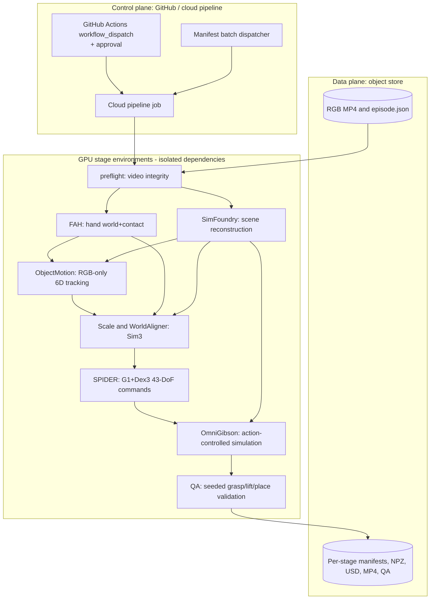

# System Architecture — Ego2Humanoid v0.2

> **v0.3 note:** MVP runs locally on a cloud devbox before cloud pipeline integration, uses HOT3D-Clips as development data (oracle + estimated modes), and validates physics in **MuJoCo** (OmniGibson post-MVP). Source layout, node images and uv setup: `docs/TECH_DESIGN.md`. The architecture below remains the target for the cloud deployment.

**Key invariant:** required input is one egocentric RGB MP4, the robot is G1+Dex3, and the acceptance output requires action-controlled, contact-driven physics success—not a visualization-only state replay.

## 1. Research-runtime separation



**Three upstream git submodules only:** `third_party/FAH`, `third_party/spider`, `third_party/SimFoundry`. Additional internal adapter stages are not additional external research submodules. Submodules pinned to verified commit SHAs; no unpinned master in production jobs.

## 2. Stable interfaces (logical IDL)

```text
Ingest.validate(episode_uri, video_local_path) -> PreflightReport
FAHAdapter.estimate_hands(EpisodeInput, video_path, output_dir) -> HandTrackBundle
SimFoundryAdapter.reconstruct_scene(EpisodeInput, video_path, output_dir) -> SceneBundle
ObjectMotionAdapter.track_objects(EpisodeInput, video_path, SceneBundle, HandTrackBundle, out) -> ObjectMotionBundle
RegistrationAdapter.align(EpisodeInput, HandTrackBundle, SceneBundle, ObjectMotionBundle, out) -> AlignedInteractionBundle
SPIDERAdapter.retarget(EpisodeInput, HandTrackBundle, SceneBundle, ObjectMotionBundle, AlignedInteractionBundle, out) -> RobotTrajectoryBundle
OmniGibsonReplayAdapter.simulate(EpisodeInput, SceneBundle, RobotTrajectoryBundle, out) -> SimRunBundle
PhysicsQAAdapter.validate(EpisodeInput, SimRunBundle, RobotTrajectoryBundle) -> QAReport
```

**Implementation files:** `src/ego2humanoid/contracts/` is the Pydantic/Protocol authority; `src/ego2humanoid/stages/adapters.py` contains deliberately incomplete upstream bridges; `contracts/episode.schema.json` is generated. `docs/DATA_CONTRACTS.md` defines binary arrays and conventions. No upstream-specific private pickle crosses an adapter boundary.

## 3. Coordinate and physical frame conventions

- `T_A_B` transforms a point from frame B into A; homogeneous `4x4`, final row `[0,0,0,1]`, proper rotation with determinant approximately +1.
- Camera optical coordinates C = `(right,down,forward)`; simulation S = right-handed, z-up; G1 physical base B = pelvis; wrist frames `L,R` named exactly by pinned MJCF.
- Scale is an **independent scalar** `scale_sim_per_world > 0`; `T_sim_world_Rt` remains SE(3), and thus no Sim(3) scale hidden inside a rotation matrix.
- `world_scale_observability=MONOCULAR_UNCERTAIN`; `scale_method` must be `estimated_from_rgb` or approved prior for a pure-RGB episode. `sim_world` is metric by selected **hypothesis** only.
- Per-frame timestamps come from decoded video PTS in seconds; create a separately recorded retargeting/control timebase and interpolation. All q radians; velocities rad/s.

## 4. Robot architecture / cross-engine parity

**Reference:** ProtoMotions `g1_dex3`: 43 actuated joint DoF (29 body + 14 finger). Fixed pelvis does NOT mean hand/wrist kinematic transport; robot arm joints and fingers are actively controlled under dynamics. G1+Dex3 full-body mapping is an M0 integration task. Do not fill a fake list of joint names.

```text
RobotAssetResolver
  ├─ read_joints_from_mjcf(asset_sha)
  ├─ validate joint_count = 43, unique named order and actuator coverage
  ├─ convert_and_import_og_robot()  # often MJCF -> USD + OG custom robot config
  ├─ check_joint_name_aliases(MJCF, OG)
  ├─ fk_parity(robot_mjcf, robot_og, 10 legal poses)
  └─ validate collisions, mass/inertia, limits, gains, finger contact links
```

Represent `robot_joint_order.json` as frozen hash + metadata and store `asset_sha256` in both `RobotTrajectoryBundle` and `SimRunBundle`. Incorrect mapping hard-fails to `ROBOT_ASSET_MISMATCH`.

## 5. Replay semantics and anti-cheating contract

For each seeded rollout:

1. Set initial robot and object state once; never inject pose frames thereafter.
2. Each controller tick sends `q_command` to active actuators, not direct `qpos` state overrides.
3. Integrate collision/contact physics (`physics_dt`), record `q_actual`, `object_pose_actual`, contacts, penetration metrics.
4. Independently infer grasp, lift, translation and rest from achieved states; no object pose from reference applied during simulation.
5. Render from achieved states after physics stepping.

`rollout_mode=ACTION_CONTROLLED` is required for accepted output. `KINEMATIC_ONLY` remains a separate debug mode not listed in accepted dataset. Since monocular RGB cannot prove metric physics, record `correspondence_to_real=UNVERIFIED_MONOCULAR` even if physics QA passes.

## 6. Artifacts and failure states

```text
run/<run_id>/episode/<episode_id>/
  input/episode.json
  hands/manifest.json / hand_tracks.npz / overlay.mp4
  scene/manifest.json / reconstructed_og_scene.json / object_assets/
  objects/manifest.json / object_tracks.npz
  alignment/manifest.json / aligned_interaction.npz
  retarget/manifest.json / robot_commands.npz / robot_joint_order.json
  simulation/manifest.json / actual_states.npz / render.mp4 / rollouts.json
  qa/report.json
```

Failures are explicit `HAND_UNTRACKED`, `SCALE_UNCERTAIN`, `OBJECT_POSE_AMBIGUOUS`, `SCENE_MESH_INVALID`, `ARM_IK_UNREACHABLE`, `ROBOT_ASSET_MISMATCH`, `RETARGET_FAILED`, `PHYSICS_REPLAY_FAILED`, `BLOCKED_LICENSE`, etc. Every failed episode still outputs a report and provenance; stages cache successful intermediates.

## 7. Deployment boundaries

The cloud pipeline uses dedicated registered image environments: `fah-env:1`, `simfoundry-env:1`, `adapter-env:1`, `spider-env:1`, `simfoundry-env:1` for replay (or `og-replay-env:1` if rendering dependencies differ), `qa-env:1`. The pipeline YAML is an **integration template** until actual registered cluster/env resources and runnable adapters exist; no existing-model performance is implied.

GitHub only submits pipeline jobs; raw video and checkpoints live in controlled storage. Use a file input for video, not a JSON string alone; stage output as folder artifacts. No job GPU task should run in GitHub hosted runners. A cloud *single sample* is one orchestrated multistage run, not a universal one-image Docker requirement.

## 8. Hard gates for development

M0: model use/license and G1 Dex3 OG/MJCF cross-engine parity; M1: FAH on real RGB; M2: SimFoundry scene + object 6D; M3: SPIDER joint/arm/finger trajectory; M4: physics contact-lift-place ≥3/5 seeded trials; M5: cloud GPU success and isolated batch-10. See `docs/IMPLEMENTATION_PLAN.md`.
