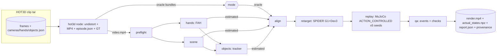

# Technical Design — Ego2Humanoid v0.3 (development-ready)

**Status:** design for implementation; task breakdown lives in `TASKS.md`.
**Supersedes** the delivery order in `docs/IMPLEMENTATION_PLAN.md` v0.2; requirements and
physics-acceptance rules in `PRD.md` remain authoritative unless changed here.

## 1. Goals and staging

| Stage | Goal | Runs on | Exit evidence |
|---|---|---|---|
| **MVP-A (oracle)** | One HOT3D golden clip end-to-end with **ground-truth** hands, objects, camera and object meshes replacing the perception stages: align → retarget (SPIDER, G1+Dex3) → **MuJoCo** action-controlled replay → QA → render | Cloud GPU devbox, local runner | `runs/.../qa/report.json` with `PHYSICS_VALIDATED` (≥3/5 seeds) or a documented `PHYSICS_FAILED` analysis; system test green |
| **MVP-B (RGB-estimated)** | Same clip from **only the undistorted RGB MP4**: FAH hands, scene, our object tracker, monocular scale; each module evaluated against HOT3D GT | Cloud GPU devbox | Module tests vs. GT within thresholds; system test in estimated mode |
| **Cloud integration** | Same DAG as a cloud pipeline of per-node images | Cloud GPU compute | One successful cloud run of MVP-A, then MVP-B |
| Post-MVP | OmniGibson backend + parity, batch-10, bimanual, caching | Cloud | See `TASKS.md` M7 |

Why this order: oracle inputs remove perception error so robot/retarget/physics problems are
isolated first (the PRD's "synthetic physical success fixture" idea, applied to real motion).
HOT3D GT then becomes the yardstick for each perception module in MVP-B.

**Glossary.** *Oracle mode* = the perception stages (`hands`, `scene`, `objects`) are replaced
by HOT3D ground truth (mocap hand poses, object 6D poses, calibrated camera, object meshes);
bundles carry `input_source=oracle_gt`. *Estimated mode* = everything is inferred from the
RGB MP4 only; GT is used solely by tests/evaluation.

### Key decisions (v0.3)

| ID | Decision | Rationale |
|---|---|---|
| D1 | Dev data = HOT3D-Clips `train_aria` | Real egocentric RGB with metric GT for camera, MANO/UmeTrack hands, object 6D poses and object meshes |
| D2 | MVP physics backend = **MuJoCo** (CPU `mujoco` for validation replay; SPIDER uses MuJoCo Warp for optimization). OmniGibson deferred | Same MJCF in retarget and replay → no cross-engine asset conversion on the critical path; runs headless without RTX |
| D3 | Robot asset candidate = Unitree `g1_29dof_with_hand` (BSD-3), as vendored by SPIDER (`spider/assets/robots/unitree_g1/g1_mocap_29dof_with_hands.xml`) or Unitree `g1_29dof_with_hand_rev_1_0`; 29 body + 2×7 Dex3 = 43 DoF. Final pick in T2.1 | Already loads in SPIDER; matches PRD 43-DoF profile |
| D4 | Package renamed `hand_pipeline` → `ego2humanoid`; stage names unchanged (`preflight, hands, scene, objects, align, retarget, replay, qa`) | Name matches scope; keeps CLI/pipeline DAG stable |
| D5 | One source tree, one Dockerfile + uv project per node | Isolated upstream deps (Py 3.10–3.12, different torch) without duplicating our code |
| D6 | Local-first orchestration; cloud only after MVP-A/B | Owner goal: prove single-episode E2E before cloud integration |
| D7 | Devbox = cloud GPU VM with **Tesla T4** (16 GB, sm_75); A100 for heavy runs | Owner decision (Q1). Every GPU node must run on T4 with reduced settings; A100 only for throughput |
| D8 | **No direct external API calls from code.** Pipeline code never calls Gemini, Vertex AI, OpenAI, etc. The only VLM path is the **Copilot relay** (§3.4): code writes request bundles, a GitHub Copilot session (Gemini model) answers them, code reads the answers | Owner decision (Q3, revised 2026-11-10): no upload path for code; Copilot is the approved channel. Enables SimFoundry Pipeline A (S-A) |

## 2. End-to-end data flow



- **Oracle mode** (MVP-A): `hot3d` node emits `hands/`, `objects/`, `scene/` bundles from GT
  with `input_source=oracle_gt`. Stages `hands`, `scene`, `objects` are skipped.
- **Estimated mode** (MVP-B): perception stages run on `video.mp4` only; HOT3D GT is used
  **only** by module tests/evaluation (`ego2humanoid.eval`), never by the pipeline.

## 3. Stage designs

Each stage: `ego2humanoid <stage> [inputs...] --out <dir>` → `<dir>/manifest.json` + NPZ/media.
Inputs are previous bundle directories. All stages write provenance (§7).

### 3.1 hot3d (dataset tooling node)
- Read clip tar (stream `214-1`, per-frame JSON). Timestamps from `info.json`/frame ids, 30 fps.
- Undistort FISHEYE624 → pinhole (fixed focal, e.g. 1408→ 704×704, f≈ chosen to keep FOV) and
  rotate upright (Aria RGB is stored rotated 90°). Implementation: `projectaria_tools`
  calibration or `hand_tracking_toolkit` camera model; verified by projection round-trip UT.
- Encode `video.mp4` (H.264, constant 30 fps, PTS preserved) and `episode.json`.
- Export GT in our frames: `K`, `T_world_camera[N]`, hand 21 landmarks (UmeTrack by default,
  MANO optional — see Q2), `T_world_object[N,O]`, visibility, object mesh paths.
- `select-golden`: run the QA event detector (§3.8) on GT object trajectories and the hand
  visibility over candidate clips; pick a single-active-hand grasp→lift→translate→place clip
  with ≥ 0.05 m lift and ≥ 0.08 m XY translation. Result pinned in `configs/golden_clips.yaml`.
- Verify world gravity axis (HOT3D world vs. z-up) using table plane fit from resting objects.

### 3.2 preflight (existing, moved)
Unchanged behavior: SHA256, ffprobe, PTS monotonicity check added.

### 3.3 hands (MVP-B)
FAH video/world mode on `video.mp4` with known `K` passed **only if** the episode declares it
(HOT3D export may provide `camera_intrinsics_source=measured` as an option for ablation).
Outputs per `HandTrackBundle`. Module test vs. GT: MPJPE / PA-MPJPE (mm), 2D PCK@10px,
handedness accuracy, coverage.

### 3.4 scene (MVP-B)
**Decision (Q3/D8 revised): S-A = SimFoundry Pipeline A with a Copilot VLM relay; S-B (local
depth + plane + primitive) is the fallback.** Runs on a ≥24 GB GPU (not T4).

SimFoundry facts (checked 2026-11-10, Apache-2.0):
- VLM calls go through `simfoundry/models/vlm.py::Gemini`, used by stages 3 (floor), 5
  (object list/classification/removal), 6 (upsample/validity), 8 (front pick), 9
  (articulation), 11 (mass/friction) and frame selection.
- `Gemini.__call__` consults `RemoteModelCache` (`CACHE_MODE=1` stores, `TEST_MODE=1` replays;
  key = hash(model, prompt, image digests, params)), and `vlm.genai.Client` can be replaced
  (`_has_patched_genai_client`). No upstream patch is needed to intercept calls.
- Image-editing calls (s5 `removal_model`, s6 `model`) already support local `flux`
  (FLUX.1-Kontext-dev).
- Stage 12 stabilizes with PyBullet; only stages 13–14 need USD/OmniGibson.

Relay design (`stages/scene/vlm_relay.py`, `stages/scene/simfoundry_runner.py`):
1. Runner sets `simfoundry.models.vlm.genai = SimpleNamespace(Client=RelayClient)` and
   `CACHE_MODE=1`, then runs stages 1b → 12 (skip 9: HOT3D objects are rigid; skip 13–14).
   Config: image edits → `flux`; text models unchanged (names are only cache-key labels).
2. `RelayClient.models.generate_content_stream(model, contents, config)`: request id =
   sha256 of (model, text parts, image bytes, temperature/seed). If
   `<run>/scene/relay/inbox/<id>.json` exists → return it as Gemini-like chunks. Otherwise
   write `outbox/<id>/{request.json, prompt.md, images/NN.png}` and raise `RelayPending`
   (derives from `BaseException` so SimFoundry's retry loop does not swallow it); the stage
   exits with code 75 (`PENDING_RELAY`).
3. Copilot step: `ego2humanoid scene relay {status,validate}` lists pending bundles. A
   Copilot session (sub-agent on a Gemini model) views each bundle's images, follows
   `prompt.md` exactly and writes `inbox/<id>.json` = `{"text": "...", "model": "...",
   "answered_by": "copilot-relay"}`. Text only: Copilot cannot return images, hence `flux`.
4. Re-run the stage; SimFoundry is file-based and resumes. Repeat until no pending bundles
   (several rounds: stage 5 removes objects one by one). Round count measured in T5.2.
5. `export_mjcf.py`: s12 GLBs + object state JSON (ground-plane frame) → `SceneBundle`
   (`scene_format="mjcf"`), convex collision via CoACD, mass/friction from s11.
6. Provenance: manifest records `vlm_backend=copilot_relay`, model label, relay request ids;
   the inbox is kept with the run so the scene is replayable with `TEST_MODE=1` (CI, cloud).

Limits: interactive, so not usable inside cloud jobs (M6 uses replayed inboxes or a local VLM
backend behind the same `RelayClient`, T7.5). Responses are not bit-reproducible; replay from
the stored inbox is. Mesh model choice (stage 7: hunyuan / trellis2 / ...) goes through Q6.

S-B fallback (only if S-A is no-go in T5.2 or fails T5.4 gates): local monocular depth (MoGe-2 class) → RANSAC
table plane → primitive (box/cylinder) object mesh → same MJCF export.

Module test: table plane normal/height error, object mesh scale/extent error vs. HOT3D model.

### 3.5 objects (MVP-B)
Mask tracking (SAM2-class) + pose fitting of the scene mesh (render-and-compare / PnP on
tracked points) → `T_world_object[N,O]`, `visibility`, `valid`, residual. Occlusion handling
per PRD (lower confidence, no hallucination). Module test vs. GT: ADD-S, rotation/translation
error, fraction of valid frames.

### 3.6 align
- `T_sim_world_Rt` gravity-aligns world to z-up; table top at a configured height.
- `scale_sim_per_world`: oracle = 1.0 (`scale_method=oracle_gt`, observability `METRIC_GT`);
  estimated = scene prior with range.
- Robot base placement `T_sim_robot_base`: start from camera pose at t0 (head position
  projected to floor, yaw from camera forward), then grid-search small offsets (x, y, yaw) to
  maximize IK reachability of the active wrist trajectory with fixed pelvis. G1 is shorter
  with shorter reach than a human: the search may move the base closer to the table.
  Failure → `ARM_IK_UNREACHABLE`.
- `contact_flags[N,2]` from hand–object proximity (oracle) or FAH contact (estimated).

### 3.7 retarget (SPIDER)
- Reuse SPIDER's pipeline: dataset processing → `preprocess/ik` (kinematic) → MJWP
  physics-informed optimization (`examples/run_mjwp.py`). SPIDER already has
  `process_datasets/hot3d.py`; our converter writes our aligned bundles into SPIDER's
  expected processed-data layout instead of re-implementing IK.
- New embodiment: G1 + Dex3, fixed pelvis, one active arm+hand (MVP), other arm and legs held
  at nominal pose. Config lives in our repo (`configs/spider/`); upstream patches, if
  unavoidable, live in `third_party_patches/spider/*.patch` and are applied in the Dockerfile.
- 5→3 finger semantics (`configs/finger_mapping.yaml`): thumb→thumb, index→index,
  middle (+ring/pinky contact patches)→middle; object-relative contact targets preferred.
- Output `retarget/` bundle: `q_target_rad[M,43]`, `ctrl[M,43]` (SPIDER actuator targets),
  `wrist_T_sim`, `base_T_sim`, joint order = `robot_joint_order.json` (from asset probe).
- FK parity: same MJCF in SPIDER and replay → parity test is a hash check + FK on 10 poses.

### 3.8 replay (MuJoCo) and qa
- Scene builder: robot MJCF (pelvis welded) + table + object (convex decomposition via CoACD
  or `object_models_eval` proxies) + floor; object mass/friction from priors (oracle: HOT3D
  model volume × density prior).
- Controller: position actuators/PD with asset gains; `control_dt=0.02`, `physics_dt=0.002`
  (from `configs/physics_validation.yaml`). Commands = SPIDER `ctrl` interpolated to control
  rate. **Guard:** after reset the code path has no writes to `qpos`/`qvel`/`mocap` (asserted
  by a wrapper that records write attempts → `state_injection_after_reset`).
- 5 seeds: perturb friction (±20%), mass (±20%), object start pose (±1 cm, ±5°).
- Record `actual_states.npz` per contract, contacts, penetration depth.
- Render: `mujoco.Renderer` with EGL (headless) → `render.mp4` (fixed scene camera; optional
  ego camera at robot head).
- QA (pure numpy, independent of SPIDER): event detector on `object_T_sim` (lift ≥ 0.05 m
  for ≥ 0.3 s, XY ≥ 0.08 m, settle |vz| < 0.05 m/s for ≥ 0.5 s), joint-limit, finite, base
  motion, penetration checks; aggregates seeds → `QAReport`.
- Risk: SPIDER optimizes in MuJoCo Warp; CPU MuJoCo replay may diverge slightly. Mitigation:
  identical MJCF/options, compare per-step states on seed 0, optional closed-loop wrist
  tracking (documented in report, never state injection).

## 4. Source layout

```text
manipulation_foundry/
├── AGENTS.md  HARNESS.md  TASKS.md  PRD.md  README.md
├── pyproject.toml  uv.lock          # core package `ego2humanoid` (dev/test env)
├── src/ego2humanoid/
│   ├── __init__.py
│   ├── contracts/                   # split from interfaces.py (Pydantic + Protocols)
│   │   ├── enums.py  episode.py  bundles.py  robot.py  qa.py  protocols.py
│   │   └── arrays.py                # NPZ key/shape/dtype specs + validators
│   ├── common/                      # io.py (manifest/NPZ), hashing.py, transforms.py (SE3/Sim3),
│   │                                # timebase.py (PTS/resample), provenance.py, video.py
│   ├── synthetic/                   # deterministic generators for smoke tests:
│   │                                # video.py, hands.py, objects.py, scene.py, trajectories.py, hot3d_tar.py
│   ├── datasets/hot3d/              # clip_reader.py, camera.py, export.py, hands_gt.py,
│   │                                # oracle.py, select_golden.py
│   ├── robot/                       # asset.py (MJCF probe/joint order), finger_map.py, kinematics.py (FK/IK)
│   ├── stages/
│   │   ├── preflight/run.py
│   │   ├── hands/   {fah_adapter.py, run.py}
│   │   ├── scene/   {vlm_relay.py, simfoundry_runner.py, export_mjcf.py, fallback_primitive.py, run.py}
│   │   ├── objects/ {tracker.py, pose_fit.py, run.py}
│   │   ├── align/   {gravity.py, scale.py, base_placement.py, run.py}
│   │   ├── retarget/{spider_convert.py, spider_runner.py, export.py, run.py}
│   │   ├── replay/  {mjcf_scene.py, controller.py, rollout.py, guard.py, render.py, run.py}
│   │   └── qa/      {events.py, checks.py, report.py, run.py}
│   ├── eval/                        # GT metrics for module tests: hands.py, objects.py, scene.py
│   ├── orchestration/               # dag.py (stage graph), local_runner.py (uv|docker)
│   └── cli/                         # main.py (typer root) + one command module per stage
├── nodes/<stage>/                   # one per stage + hot3d: Dockerfile, pyproject.toml, uv.lock,
│                                    # .python-version, component.yml (cloud, M6)
├── configs/                         # physics_validation.yaml, finger_mapping.yaml, golden_clips.yaml,
│                                    # spider/, submodules.lock.json, pipeline/{oracle,estimated}.yaml
├── assets/robots/g1_dex3/           # pinned MJCF + meshes (BSD-3, small) + robot_joint_order.json
├── third_party/                     # git submodules: FAH, spider, SimFoundry (pinned)
├── third_party_patches/             # only if upstream patching is unavoidable
├── pipeline/                        # pipeline.yml (references nodes/*/component.yml)
├── scripts/                         # build_node.sh, smoke_node.sh, download_hot3d.sh, gen_schema.py, submit_batch.py
├── tests/{unit,smoke,module,system}/  conftest.py
├── docs/
├── data/   (git-ignored except README.md)
└── runs/   (git-ignored)
```

Rules: ≤ 1000 lines per file; `stages/*` import from `contracts`, `common`, `robot`, but not
from each other; heavy third-party imports (torch, mujoco, fah, spider) are imported inside
the stage module that needs them so the core package stays importable on CPU-only machines.

## 5. Dependency management (uv) and node images

**Core project** (`/pyproject.toml`): package `ego2humanoid`, `requires-python >=3.10`,
deps `pydantic, numpy, typer`; extras `video` (av / opencv-python-headless), `sim` (mujoco),
`hot3d` (projectaria-tools or hand_tracking_toolkit, trimesh); dependency group `dev`
(pytest, ruff, pyyaml). Root `uv.lock` drives the GPU-free dev/test env.

**Node projects** (`nodes/<stage>/pyproject.toml`, `[tool.uv] package = false`):

```toml
[project]
name = "e2h-node-replay"
version = "0.1.0"
requires-python = "==3.12.*"
dependencies = ["ego2humanoid[sim,video]"]

[tool.uv.sources]
ego2humanoid = { path = "../..", editable = false }
```

Upstream code enters as path sources when installable (e.g. `spider = { path =
"../../third_party/spider" }`, `fah = { path = "../../third_party/FAH" }`); each node has its own
`uv.lock` and `.python-version`.

| Node | Base image | Python | GPU | Main deps |
|---|---|---|---|---|
| hot3d | python:3.11-slim | 3.11 | no | `ego2humanoid[hot3d,video]` |
| preflight | python:3.11-slim (+ffmpeg) | 3.11 | no | core |
| hands | nvidia/cuda:12.8-runtime-ubuntu22.04 | 3.11 | yes | FAH, torch cu128 |
| scene | nvidia/cuda runtime | per SimFoundry | yes (≥24 GB) | SimFoundry (stages 1b–12), FLUX.1-Kontext, trimesh, CoACD; S-B fallback deps |
| objects | nvidia/cuda runtime | 3.11 | yes | SAM2-class tracker, torch |
| align | python:3.11-slim | 3.11 | no | `ego2humanoid[sim]` (IK reachability) |
| retarget | nvidia/cuda runtime | 3.12 | yes | SPIDER, mujoco-warp |
| replay | ubuntu + libegl (osmesa fallback) | 3.12 | optional | `ego2humanoid[sim,video]` |
| qa | python:3.11-slim | 3.11 | no | core |

Dockerfile template (build context = repo root, `.dockerignore` excludes `data/ runs/ .git`):

```dockerfile
FROM python:3.11-slim
COPY --from=ghcr.io/astral-sh/uv:0.9 /uv /uvx /bin/
ENV UV_COMPILE_BYTECODE=1 UV_LINK_MODE=copy UV_PROJECT_ENVIRONMENT=/opt/venv PATH=/opt/venv/bin:$PATH
WORKDIR /app
COPY nodes/qa/pyproject.toml nodes/qa/uv.lock nodes/qa/.python-version nodes/qa/
COPY pyproject.toml README.md ./
COPY src/ src/
RUN uv sync --frozen --no-dev --project nodes/qa
COPY configs/ configs/
ENTRYPOINT ["ego2humanoid"]
```

Each image is smoke-tested by `scripts/smoke_node.sh <stage>` (runs the stage on synthetic
input inside the container). Restricted weights are mounted (`-v $FAH_HOME:/models/fah`).

**T4 constraints (D7):** sm_75 → no bf16 / FlashAttention-2; use fp16 or fp32. Verify the
chosen PyTorch CUDA wheel still ships sm_75 kernels (pin a cu12x wheel that does). SPIDER
MJWP: reduce sample count / horizon to fit 16 GB; full-quality runs may move to A100.
FAH: start with FAH-S/B on T4, FAH-L on A100 if needed. Headless rendering uses NVIDIA EGL.

**Compute-instance storage:** keep the repo, `data/` and `runs/` on the instance's local disk,
not on the network share, so large files are not synced to cloud storage.

## 6. Contracts v1.2 (delta from v1.1)

| Change | Reason |
|---|---|
| `StageBundle.input_source: Literal["rgb_estimated","oracle_gt"]` | Distinguish MVP-A vs MVP-B everywhere |
| `world_scale_observability` adds `METRIC_GT`; `scale_method` adds `oracle_gt` | HOT3D GT is metric |
| `SceneBundle.scene_format` adds `"mjcf"` | MuJoCo backend |
| `RobotAssetSpec`: OG fields optional; add `sim_backend: Literal["mujoco","omnigibson"]` | OmniGibson deferred |
| `SimRunBundle.sim_backend` | Provenance |
| `RobotTrajectoryBundle` adds optional `ctrl_npz_key="ctrl"` | SPIDER emits actuator targets |
| `contracts/arrays.py` | Machine-checkable NPZ specs used by every stage and every smoke test |

Physics anti-cheat invariants (v1.1) are unchanged. Oracle-mode acceptance policy: see Q4.

## 7. Run layout, provenance, determinism

```text
runs/<run_id>/<episode_id>/{input,hands,scene,objects,alignment,retarget,simulation,qa}/
runs/<run_id>/provenance.json   # git sha, submodule shas, uv.lock hashes, image digests,
                                # config hashes, data sha256, seeds, devbox spec, timings
```
`run_id = <UTC timestamp>-<mode>-<short git sha>`. Seeds are explicit in configs.

## 8. Testing strategy (maps to HARNESS §4)

| Module | Unit tests | Smoke (synthetic) | Module (HOT3D) |
|---|---|---|---|
| contracts/arrays | shape/dtype/SE3 validators | — | — |
| common/transforms | SE3/Sim3 compose/invert, quaternion order | — | — |
| hot3d | fisheye round-trip, quaternion wxyz→matrix, landmark FK | synthetic tar → MP4 + bundles | real clip export; reprojection of GT objects onto MP4 |
| hands | output conversion | fake FAH output → bundle | FAH vs GT MPJPE / PCK |
| scene | table plane fit | synthetic depth → plane + MJCF | plane/scale error vs GT |
| objects | pose fit on synthetic points | rendered moving box video | ADD-S vs GT |
| align | gravity, base placement search | synthetic hand+object → bundle | oracle alignment residual, reachability |
| retarget | finger map, converter | synthetic trajectory through converter + short IK | golden clip IK error, joint limits |
| replay | guard, controller math | synthetic cube scripted grasp (≥3/5) | golden clip SPIDER ctrl replay |
| qa | event detector edge cases | synthetic trajectories pass/fail | GT object trajectory passes detector |
| system | — | full DAG on synthetic data (CPU, fast config) | full DAG oracle (MVP-A), estimated (MVP-B) |

## 9. Risks specific to the MVP path

| Risk | Detection | Mitigation |
|---|---|---|
| HOT3D clips are 5 s; full grasp→lift→place may not fit in one clip | T1.7 selector finds none | Concatenate consecutive clips of one sequence via `clip_definitions.json`, or relax `place` gate for MVP-A (owner decision) |
| G1 reach/height mismatch with human motion | T3.2 reachability | Base placement search; MVP accepts object-relative (not absolute) wrist targets |
| SPIDER has no G1+Dex3 combined embodiment config | T3.3 study | Custom config in `configs/spider/`; minimal patch file if needed |
| MuJoCo Warp vs CPU MuJoCo divergence | T4.2 seed-0 comparison | Identical options; or run replay in MuJoCo Warp too (documented) |
| Headless rendering on cloud VM | T2.8 | EGL, fallback OSMesa |
| T4 too small/slow for SPIDER MJWP or FAH-L | T3.4 / T5.1 timing + VRAM log | Reduced configs on T4; switch the run to A100 |
| SimFoundry relay needs too many rounds or Copilot answers break SimFoundry parsers | T5.2 spike: round count, parse failures | Tighten relay instructions per prompt type; else S-B fallback |
| SimFoundry install conflicts with uv / node image (conda, ~250 GB assets) | T5.2 | Scene node image built from SimFoundry's own env; our code runs as a thin layer inside it |
