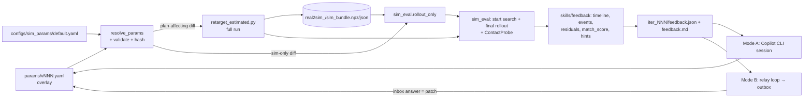

# Track RSI — Parameter-tunable agentic real2sim (technical design)

**Status:** implemented (SimParams, resolver, bundle, probes, feedback, tiered runner, Mode A/B, robustness; see `TASKS.md` for what is still open). Sections 2 and 5 describe the pre-implementation
state and the planned diffs (history). Paths below are relative to `src/` unless prefixed `scripts/` or `configs/`. Tasks: `TASKS.md` → Track RSI. Inspired by RoboSimStudio (arXiv 2610.18835):
explicit, editable physics choices + spatio-temporal simulator feedback that a human or coding
agent iterates on. Adapted to this repo: **MuJoCo stays, no GUI, RGB-only references.**

## 1. Goal, scope, non-goals

**Goal.** For one clip and one hand, an agent can iterate
`edit parameters → run (rollout-only or full) → read structured feedback → edit` until the
simulated episode passes QA and matches the video estimates as closely as monocular data allows,
with every iteration reproducible from files.

**In scope.**
1. `SimParams`: one versioned, validated parameter set covering object physics, contact model,
   PD gains/timestep, grasp/place trajectory constants and scene-structure overrides.
2. Tiered re-run: plan-independent changes replay the cached trajectory; plan-affecting changes
   re-run the retarget.
3. Spatio-temporal feedback: phase timeline, contact/slip/eject/penetration events, sim-vs-video
   residuals, a scalar `match_score`, and rule-based parameter attribution hints.
4. Two agent modes over the same files: **A** (a Copilot CLI session drives the CLI) and **B**
   (a code-driven loop that asks through the existing Copilot relay).

**Non-goals.** GUI/Viser; Newton/MuJoCo-Warp/GPU backends; deformables; automatic system
identification (gradient/Bayesian optimisation); tuning QA thresholds; changing perception; Dex3
(Sharpa only, owner 2026-11-15); track L loco rollouts (they can adopt `SceneConfig.from_params`
later).

## 2. State at design time (history) and gaps

| Concern | Where today | Gap |
|---|---|---|
| Contact model | `ObjectContact` dataclass defaults, `mjcf_scene.py:23`; `CONTACT_IMPRATIO` module const | Code edit to change |
| PD / timestep | `PDConfig` defaults, `mjcf_scene.py:56`; Sharpa wrist ×2.5 `HEAVY_HAND_WRIST_SCALE` | Code edit |
| Object mass/friction | `physics_params.py` (VLM json or keyword table, clamps 30 g–1 kg, μ 0.2–2) | No override |
| Trajectory constants | ~45 module constants in `scripts/retarget_estimated.py` (13 via `E2H_*` env), `stages/retargeting/grip.py:31-35`, `stages/retargeting/hand_eye.py:27-37` | Scattered, undocumented ranges, env only for some |
| Scene structure | `BoxObject.static/robot_collision`, roles in `stages/reconstruction/scene/inventory.py` | No override |
| Fast re-run | `E2H_RETARGET_CACHE` (pickled placement retarget), `E2H_DUMP` (pickled final scene inputs, debug only) | No rollout-only entry point; pickle |
| Feedback | `detect_pick_place` booleans + `failure_reasons`; `retarget_rgb*.json`; review video | No timeline, no slip/penetration log, no comparison to video timing, no attribution |
| Agent channel | `stages/reconstruction/scene/vlm_relay.py` (`RelayClient`, exit 75) for SimFoundry only | No real2sim request type |
| File size | `retarget_estimated.py` 1267 lines (> HARNESS 1000 limit) | Must shrink, not grow |

## 3. Architecture



All artefacts live under `<clip>/real2sim_<hand>/` (git-ignored `data/`):

```text
<clip>/real2sim_sharpa/
  sim_bundle.npz, sim_bundle.json      # frozen plan + references (§6)
  params/v000.yaml … vNNN.yaml         # overlays written by the agent (only changed keys)
  iter_000/ … iter_NNN/
    params.yaml (resolved)
    rollout.npz                        # rollout arrays + probe arrays
    feedback.json, feedback.md
    review/ (optional RENDER=1)
  history.jsonl                        # one line per iteration (§10.3)
  accepted.yaml                        # promoted params (§12)
  loop_state.json                      # mode B only
```

## 4. `SimParams` contract

### 4.1 Model

New contract module `src/contracts/sim_params.py` (pydantic, frozen, `extra="forbid"`).
Every leaf field carries metadata via `Field(json_schema_extra={...})`:

| Meta key | Meaning |
|---|---|
| `unit` | SI unit string (`m`, `kg`, `s`, `N`, `N/m`, `1`, `frames@30Hz`, `deg`) |
| `range` | `[lo, hi]` hard bounds; violation is a validation error |
| `affects` | subset of `{"sim", "plan"}`: `plan` = the value is an input to retargeting/grip sizing/table fit, so changing it invalidates the cached trajectory |
| `doc` | one line, shown in the schema table |

Top-level:

```python
class SimParams(BaseModel):
    version: Literal["sim_params/1"]
    objects: dict[str, ObjectPhysics]  # selector -> overrides (§4.3)
    contact: ContactParams
    pd: PDParams
    trajectory: TrajectoryParams
    scene: SceneOverrides
```

### 4.2 Fields and defaults (defaults = today's values, must reproduce today's runs)

**`ObjectPhysics`** (per selector; `None` = keep the estimate)

| Field | Default | Unit | Range | Affects | Today |
|---|---|---|---|---|---|
| `mass_kg` | None | kg | 0.005–2.0 | sim, plan | `physics_params` estimate (grip force sizing uses mass) |
| `friction` | None | 1 | 0.05–3.0 | sim, plan | estimate; grip sizing uses μ |
| `min_mass_kg` | 0.03 | kg | 0.0–0.2 | sim, plan | `MIN_MASS_KG` |
| `max_mass_kg` | 1.0 | kg | 0.1–5.0 | sim, plan | `_MAX_MASS_KG` |
| `min_thickness_m` | 0.04 | m | 0.0–0.1 | plan | `MIN_OBJECT_THICKNESS_M` / `E2H_MINTHICK` |
| `max_extrude_aspect` | 2.0 | 1 | 1–inf | plan | `MAX_EXTRUDE_ASPECT["sharpa"]` |
| `slab_max_width_m` | 0.025 | m | 0–0.06 | plan | `SLAB_MAX_WIDTH_M` |

**`ContactParams`** (all `sim` only)

| Field | Default | Unit | Range | Today |
|---|---|---|---|---|
| `mode` | `"priority"` | enum `priority\|mix` | — | `object_contact=None` ⇔ `mix` |
| `priority` | 1 | 1 | 0–5 | `ObjectContact.priority` |
| `condim` | 4 | enum 1,3,4,6 | — | `ObjectContact.condim` |
| `solref` | [0.01, 1.0] | [s, 1] | timeconst ≥ 2·`pd.timestep_s` and ≤ 0.1; dampratio 0.1–2 | `ObjectContact.solref` (cross-field check) |
| `solimp` | [0.95, 0.99, 0.001] | [1,1,m] | d0,dwidth 0.5–0.9999, d0≤dwidth, width 1e-4–0.01 | `ObjectContact.solimp` |
| `min_slide_friction` | 1.0 | 1 | 0–3 | `ObjectContact.min_slide_friction` (**also `plan`**: grip sizing reads it) |
| `torsion_m` | 0.01 | m | 0–0.05 | `ObjectContact.torsion_m` |
| `roll_m` | 0.0001 | m | 0–0.01 | `ObjectContact.roll_m` |
| `impratio` | 10 | 1 | 1–100 | `CONTACT_IMPRATIO` (`mjcf_scene.py:254`) **and** a second hard-coded 10.0 in `robot/sharpa.py:92`; the params value must be applied after `attach_sharpa_hands` |
| `cone` | `"elliptic"` | enum | — | `mjcf_scene.py:253` and `robot/sharpa.py:91` (same rule) |
| `noslip_iterations` | 5 | 1 | 0–50 | `SceneConfig.noslip_iterations` |
| `table_friction` | [1.0, 0.005, 0.0001] | [1,m,m] | ≥ 0 | `SceneConfig.table_friction` |

**`PDParams`**

| Field | Default | Affects | Today |
|---|---|---|---|
| `groups.{hand,wrist,shoulder,elbow,waist,legs}.{kp,kd,max_torque_nm,armature}` | as `PDConfig` (hand 8/0.4/6/0.005, wrist 40/2/20/0.01, shoulder/elbow 150/6/60/0.02, waist 300/10/100/0.02, legs 300/10/150/0.02) | `hand.kp`: sim+plan (`hold_pinch_stiffness` sizes the squeeze from the hand kp; arm gains cancel in `J_t − J_i`); all others: sim | `PDConfig.groups` |
| `heavy_hand_wrist_scale` | 2.5 | sim | `HEAVY_HAND_WRIST_SCALE["sharpa"]` (`mjcf_scene.py:212`) |
| `gravity_compensation` | true | sim | `PDConfig` |
| `timestep_s` | 0.002 (range 0.0005–0.004) | sim | `PDConfig.timestep_s` |
| `integrator` | `"implicitfast"` | sim | scene option |

The group keys stay the substrings used by `_gains_for` (`_hand_`, `wrist`, …), mapped by name.

**`TrajectoryParams`** (all `plan`; names keep the code constant in snake case)

| Group | Fields (default) | Today |
|---|---|---|
| Grip sizing | `squeeze_m` 0.012, `max_squeeze_m` 0.02, `grip_min_n` 4.0, `safety_factor` 2.0, `max_tan_alpha` 0.7, `contact_allowance_m` 0.002, `carry_accel_m_s2` 3.0 | `retarget_estimated.py:150-155`, `grip.py:31-35` |
| Approach/close | `approach_frames` 30, `close_ramp_frames` 6, `close_lead_frames` 12, `open_margin_m` 0.02, `open_pad_m` 0.015, `max_open_extra_m` 0.04, `hover_clearance_m` 0.015, `max_hover_rise_m` 0.06, `settle_frames` 9, `approach_height_m` 0.03, `pad_reach_m` 0.015, `tip_floor_m` 0.006 | script consts, `hand_eye.py` |
| Place/release | `place_dwell_frames` 15, `place_lead_frames` 20, `place_xy_lead_frames` 25, `release_open_frames` 6, `retreat_frames` 8, `retreat_height_m` 0.04, `retreat_blend_frames` 10, `bare_place_lift_m` 0.003 | script consts / env |
| Hand-eye | `pinch_tol_m` 0.005, `max_iters` 4, `align_max_offset_m` 0.30 (per-iteration clip in `align_pinch`), `phase_max_offset_m` 0.20 (object/receptacle-relative shift in the script) | `hand_eye.py:27-29`, `retarget_estimated.py:81` (two different constants, both named `MAX_OFFSET_M`) |
| Table/clearance | `table_margin_m` 0.30, `table_inset_m` 0.05, `table_near_edge_m` 0.10, `scene_table_margin_m` 0.08, `obstacle_margin_m` 0.02, `held_margin_m` 0.003, `held_clearance_m` 0.005 | script consts / env |
| Start search | `start_search_m` 0.03, `start_grid` 5 (odd, 1–9) | `START_SEARCH_M`, `OFFSETS_M` |
| Switches | `scene_objects` true, `adjust_stance` true, `place_stance_search` true, `place_reach_weight_m` 0.1 (BF.9: stance score of the place window) | `E2H_SCENE_OBJECTS`, `E2H_ADJUST_STANCE` |

Constants that are perception heuristics (`MIN_SCORE`, `MIN_PICK_RISE_M`, `GRIP_REACH_TOL_M`,
EgoTac `CONTACT_PROB`) are **not** in `SimParams`: they decide what the video shows, not how the
sim behaves, and tuning them would let the agent re-interpret the reference.

**`SceneOverrides`**

| Field | Type | Affects | Notes |
|---|---|---|---|
| `objects.<selector>.enabled` | bool (true) | plan | drop a scene object (supports/table fit change) |
| `objects.<selector>.static` | bool \| None | sim | weld/unweld (RSS sponge-wipe fix: fixed → free) |
| `objects.<selector>.robot_collision` | bool \| None | sim | contype bits as `_ROBOT_EXEMPT_BITS` |
| `objects.<selector>.pos_offset_m` | [dx,dy,dz] (0) | plan | ±0.10 m |
| `objects.<selector>.yaw_offset_deg` | float (0) | plan | ±180 |
| `objects.<selector>.size_scale` | [sx,sy,sz] (1) | plan | 0.5–2.0 |
| `table.top_z_m` | float \| None | plan | None = `fit_table_height` |
| `table.friction` | → `contact.table_friction` | — | alias, not duplicated |

### 4.3 Object selectors

Resolved against the scene at build time, most specific wins:
`"held"` (the grasp object, today `BoxObject("perceived")`), `"receptacle"`, `"source"`,
an inventory item name (`SceneInventory` names, as in `inventory.json`), `"*"` (all free objects).
Unknown selectors are an error at resolution time **for the clip** (listed in the error with the
valid names), so a typo never silently does nothing.

### 4.4 Files and resolution

* `configs/sim_params/default.yaml`: full defaults (generated from the model by
  `scripts/sim_params.py dump-defaults`; CI test asserts file == model defaults).
* Overlay files contain only changed keys (deep merge; lists replace).
* Resolution order: model defaults → `default.yaml` → `$E2H_SIM_PARAMS` (path, e.g. an
  `accepted.yaml`) → legacy `E2H_*` env vars (mapped table in `skills/params/legacy_env.py`, each
  hit logged `deprecated env E2H_SQUEEZE -> trajectory.squeeze_m`) → `--params` overlay(s) →
  `--set a.b=c` CLI pairs.
* `params_hash` = sha256 of canonical JSON (sorted keys, floats `repr`) of the resolved model, first
  16 hex chars; written to every report (`retarget_rgb*.json["sim_params_hash"]`) and iteration.
* `diff(a, b) -> list[ParamChange(path, old, new, affects)]`; `needs_plan(changes) = any("plan" in c.affects)`.

## 5. Code integration (minimal diffs)

| File | Change |
|---|---|
| `contracts/sim_params.py` (new) | models of §4; `contracts/*.schema.json` regenerated; `docs/DATA_CONTRACTS.md` |
| `skills/params/{resolve.py,legacy_env.py,scene_overrides.py}` (new) | overlay/merge, env mapping, hash, diff, selector resolution, scene overrides |
| `stages/manipulation/mjcf_scene.py` | `ObjectContact.from_params`, `PDConfig.from_params`, `SceneConfig.from_params(params, **geometry)`; `impratio`, `cone`, `integrator` move from module const to `SceneConfig` fields with today's defaults. Dataclass defaults unchanged so every existing caller is bit-identical. |
| `stages/reconstruction/objects/physics_params.py` | `apply_overrides(estimate, ObjectPhysics) -> dict` (clamps from params) |
| `stages/retargeting/grip.py`, `hand_eye.py` | module constants become keyword defaults of the functions that use them; callers pass params. No logic change. |
| `scripts/retarget_estimated.py` | at the top: `P = resolve_params(args)`; module constants assigned from `P` (keeps the rest of the diff small); start-offset search, final rollouts and metric rollouts move to `stages/manipulation/sim_eval.py`; writes the sim bundle; replaces the `E2H_DUMP` pickle. Target: file < 1000 lines after the move. |
| `stages/manipulation/sim_eval.py` (new) | `start_search(bundle, params, offsets) -> SearchResult`, `final_rollout(...)`, `metrics(...)`; used by the full run and by rollout-only |
| `stages/manipulation/probes.py` (new) | `ContactProbe` (`on_record` callback, §7.2) |
| `rsi/{runner.py,history.py,loop.py,prompt.py,answer.py,robust.py,schema.py}` + `rsi/backends/mujoco.py` (new) | tiered runner, history, mode B, answer validation, robustness, simulator backend |
| `skills/{feedback.py,residuals.py,attribution.py,feedback_md.py}` (new) | §7–§9 |
| `contracts/real2sim.py` (new) | `Real2SimFeedback`, `HistoryEntry`, `RelayParamAnswer` |
| `stages/reconstruction/scene/vlm_relay.py` | add `submit_request(relay_dir, rid, prompt_md, images, meta)` and `read_answer(relay_dir, rid)`: factor out of `_write_request`/`answer`; existing SimFoundry path unchanged |
| `scripts/sim_params.py`, `scripts/real2sim_eval.py`, `scripts/real2sim_loop.py` (new) | CLIs (§10, §11) |

`rollout.py` is not changed: probes attach through the existing `on_record` hook.

**Invariant test (RSI.4):** for every leaf whose `affects == {"sim"}`, changing it must leave the
planned `q_target_rad` bit-identical (run the synthetic fixture with each field perturbed inside its
range). This proves the tier classification; a failing field is re-classified `plan`.

## 6. Sim bundle (frozen plan + references)

Written by the full run at the point where `E2H_DUMP` is written today. `allow_pickle=False`.

`sim_bundle.json`:
`{version, clip, hand, side, params_hash, plan_params_hash (hash of plan-affecting leaves only),
created_utc, git_commit, T_sim_robot_base, table_kw, drop_point_m|null, demo_carry_m,
release_t_s, close_start_idx, release_idx, best_offset_m, objects:[{name, role, half_size_m,
pos_m, static, robot_collision, mass_kg, friction, has_mesh, n_pieces}], tactile_timing|null,
phase_frames:{approach:[a,b], close:[a,b], hold:[a,b], carry:[a,b], place:[a,b], release:[a,b], retreat:[a,b]}}`

`sim_bundle.npz`:

| Key | Shape | Content |
|---|---|---|
| `timestamps_s` | (M,) | plan time base (50 Hz) |
| `q_target_rad` | (M, 73) | planned actuator targets |
| `obj{i}_mesh_vertices/faces/uv`, `obj{i}_texture`, `obj{i}_piece{j}_v/f` | … | geometry of `BoxObject` i (same arrays `BoxObject` carries) |
| `ref_t_s` | (N,) | clip time base (30 Hz, trimmed span) |
| `ref_human_pinch_m` | (N, 3) | thumb–index midpoint in sim frame (after table shift) |
| `ref_target_pinch_m` | (N, 3) | robot pinch target after hand-eye correction |
| `ref_held_track_t_s`, `ref_held_track_m` | (K,), (K, 3) | perceived held-object centroid at detection frames (`select_held_object` picks) |
| `ref_tactile_on` | (N,) bool | EgoTac pinch contact (`pinch_contact`) if available |

`sim_eval.load_bundle()` rebuilds `SceneConfig` from bundle + params via `SceneConfig.from_params`.
Bundle validity: rollout-only is allowed iff `plan_params_hash(current) == bundle.plan_params_hash`
(or `--freeze-plan`, §10.2).

## 7. Spatio-temporal feedback

### 7.1 Inputs

Rollout arrays (`timestamps_s, q_command_rad, q_actual_rad, wrist_actual_T_sim, object_T_sim,
object_robot_contact`), `SimTactile` arrays with `partner="object"`, `ContactProbe` arrays, bundle
phase frames and references, `PickPlaceEvents`.

### 7.2 `ContactProbe` (per recorded frame, 50 Hz)

| Array | Shape | Definition |
|---|---|---|
| `pen_robot_table_m` | (T,) | max of `-contact.dist` over robot–table contacts (0 if none) |
| `pen_robot_object_m` | (T, n_obj) | same, robot–object i |
| `pen_object_support_m` | (T, n_obj) | object i vs table/other objects |
| `force_robot_object_n` | (T, n_obj) | sum of normal force (`mj_contactForce`) robot–object i |
| `obj_speed_m_s`, `obj_ang_speed_rad_s` | (T, n_obj) | from `cvel` of the object body |
| `finite` | (T,) bool | all qpos/qvel finite |

### 7.3 Phase timeline

From `bundle.phase_frames` mapped to rollout time (approach, close, hold, carry, place, release,
retreat, idle). Every event carries its phase.

### 7.4 Event detectors (`skills/feedback.py`, pure numpy, unit-tested on hand-made arrays)

Constants are detector constants (in code, not `SimParams`).

| Event | Rule |
|---|---|
| `CONTACT_ON/OFF` (per object) | `object_robot_contact` runs, merged across gaps < 0.04 s |
| `FIRST_TOUCH`, `LAST_TOUCH` | first/last contact of the held object |
| `LIFT_OFF` | held object z > rest + 0.01 m for ≥ 0.1 s |
| `SLIP` | in contact during hold/carry, object pose in the active wrist frame drifts > 5 mm (or > 10°) within 0.2 s; reports drift mm, direction (wrist frame), phase |
| `ROTATE_IN_GRASP` | rotation part of the above > 15° with < 5 mm translation |
| `EJECT` / `DROP` / `AIRBORNE_RELEASE` / `STUCK` | from `PickPlaceEvents` fields (times added) |
| `PENETRATION` | any `pen_*` > 5 mm for ≥ 0.06 s; reports pair class, peak mm, duration |
| `TRACKING_ERROR` | per joint group `|q_actual − q_command|` peak > group limit (hand 0.15 rad, arm 0.05 rad) for ≥ 0.1 s |
| `GRIP_FORCE` | per hold phase: median / min of `force_robot_object_n` for the held object vs the sized grip force from the plan |
| `DISTURBED` | free scene object displaced > `DISTURBED_M` (reuse `inventory.disturbance`) |
| `SIM_UNSTABLE` | `!finite` or object speed > 3 m/s or angular > 50 rad/s |

Consecutive identical events are merged; the timeline is capped at 40 entries (most severe first
per phase).

### 7.5 Sim-vs-video residuals (`skills/residuals.py`)

Displacement-based to cancel monocular absolute offsets; `t_g` = sim grasp time (`FIRST_TOUCH`
sustained), `h_g` = human grasp onset (EgoTac `grasp_onset_s`, else plan close start).

| Residual | Formula | Scale `s_k` |
|---|---|---|
| `carry_path_m` | RMS over carry of `‖(p_obj(t)−p_obj(t_g)) − (p_pinch_h(t')−p_pinch_h(h_g))‖`, `t' = t − t_g + h_g` | 0.05 m |
| `lift_ratio` | `|1 − lift_sim / lift_human|`, lift_human = `grasp_rise_m` or held-track rise | 0.5 |
| `grasp_dt_s` | `|t_g − h_g|` | 0.3 s |
| `release_dt_s` | `|LAST_TOUCH − release_t_s|` | 0.3 s |
| `place_err_m` | final object xy vs drop point (receptacle) or vs human release pinch xy + carry offset | 0.05 m |
| `held_track_m` | median distance sim object vs `ref_held_track_m` after aligning the first sample (only if ≥ 5 samples) | 0.08 m |
| `tactile_iou` | 1 − IoU over time of sim pinch contact vs `ref_tactile_on` (if EgoTac) | 1 |

### 7.6 `match_score` (lower is better)

```
if not events.success:   match_score = 1 + severity(failure_reasons)   # 1.x, worst first
else:                    match_score = Σ_k w_k · min(r_k / s_k, 1) / Σ_k w_k   ∈ [0, 1)
```
Weights `w`: carry 3, lift 1, grasp_dt 2, release_dt 1, place 3, held_track 1, tactile 1 (missing
residuals drop out). `severity`: SIM_UNSTABLE 0.9, NO_CONTACT 0.8, NO_LIFT 0.7, EJECTED 0.6,
DROPPED_IN_CARRY 0.5, NOT_PLACED 0.3, AIRBORNE_RELEASE 0.2, STUCK_AFTER_RELEASE 0.1 (max over
reasons). Weights and scales are code constants of the feedback module, not agent-tunable.

## 8. Attribution hints (`skills/attribution.py`)

Rule table: `pattern → [(param_path, direction, why)]`. Each hint is emitted with the current value,
range, `affects` (so the agent sees the re-run cost). Initial rules:

| Pattern | Suggested parameters (direction) |
|---|---|
| `SIM_UNSTABLE` | `contact.solref[0]` ↑, `pd.timestep_s` ↓, `contact.impratio` ↓ |
| No contact with held object | `scene.objects.held.pos_offset_m`, `trajectory.start_search_m` ↑, `objects.held.min_thickness_m` ↑, `trajectory.hover_clearance_m` ↓ |
| `EJECT` within close phase ±0.2 s | `trajectory.squeeze_m` ↓, `contact.solref[0]` ↑ (softer), `objects.held.mass_kg` ↑, `contact.condim` → 6 |
| `SLIP` / `DROPPED_IN_CARRY` | `objects.held.friction` ↑, `contact.min_slide_friction` ↑, `trajectory.grip_min_n` ↑, `trajectory.carry_accel_m_s2` ↓, `contact.noslip_iterations` ↑, `pd.groups.hand.kp` ↑ |
| `ROTATE_IN_GRASP` | `contact.torsion_m` ↑, `contact.condim` → 6 |
| Grip force ≪ sized force | `pd.groups.hand.kp` ↑, `pd.groups.hand.max_torque_nm` ↑, `trajectory.squeeze_m` ↑ |
| `STUCK_AFTER_RELEASE` | `trajectory.release_open_frames` ↓, `trajectory.retreat_height_m` ↑, `trajectory.open_pad_m` ↑ |
| `AIRBORNE_RELEASE` | `trajectory.place_dwell_frames` ↑, `trajectory.bare_place_lift_m` ↓ |
| `NOT_PLACED` (receptacle) | `trajectory.place_lead_frames`, `scene.objects.receptacle.pos_offset_m` |
| Receptacle / scene object `DISTURBED` | `scene.objects.<name>.static` true, `objects.<name>.mass_kg` ↑ |
| Unintended `PENETRATION` robot–table | `scene.table.top_z_m` ↓, `trajectory.table_near_edge_m` ↑ |
| `grasp_dt_s` large, sim earlier/later | `trajectory.close_lead_frames` ∓ |
| `lift_ratio` large while successful | `trajectory.max_hover_rise_m`, `objects.held.min_thickness_m` |
| Hand `TRACKING_ERROR` under load | `pd.groups.hand.kp` ↑, `pd.groups.hand.max_torque_nm` ↑ |

Hints are suggestions; the agent may choose others. Rules are code (one table), tested per rule.

## 9. Feedback outputs

`feedback.json` (`Real2SimFeedback` contract):
`{version, clip, hand, iter, params_hash, parent_iter, tier_run: "rollout"|"full", plan_frozen,
qa:{success, failure_reasons, lift_height_m, translation_m, place_error_m}, residuals:{…},
match_score, phases:[{name,t0,t1}], events:[{t_s, phase, kind, object, detail}],
hints:[{pattern, param, current, range, direction, affects, why}], wall_time_s}`

`feedback.md` (≤ 60 lines, the only thing the agent must read), template:

```text
# clip 0 · sharpa · iter 3 (parent 2) · rollout-only · params 4f2a…  → FAIL 1.50 (DROPPED_IN_CARRY)
QA: lift 6.1 cm, carry 4.2 cm (need 7.5), place err —
Residuals: carry_path 3.8 cm (0.76) · grasp_dt 0.10 s · release_dt — · tactile 1-IoU 0.41
Timeline:
  1.62 s close   FIRST_TOUCH held (thumb_tip, index_tip)
  1.80 s hold    LIFT_OFF held
  2.05 s carry   SLIP held 7 mm along wrist −y in 0.2 s; grip force 1.9 N (sized 4.0 N)
  2.31 s carry   CONTACT_OFF held → DROP (z 6 cm → table)
Hints (affects):
  objects.held.friction 0.6 → ↑ [0.05, 3] (sim+plan)
  pd.groups.hand.kp 8 → ↑ [1, 50] (sim+plan)
  trajectory.carry_accel_m_s2 3.0 → ↓ [0.5, 10] (plan)
Changed vs parent: contact.noslip_iterations 5 → 10
```

## 10. Runner and Mode A (Copilot CLI session)

### 10.1 CLI (`scripts/real2sim_eval.py`, uv env, `HAND=sharpa`)

| Command | Action |
|---|---|
| `init <clip>` | full `retarget_estimated.py` with default/accepted params → bundle, `iter_000` |
| `schema [--affects sim]` | parameter table (path, current, unit, range, affects, doc) |
| `eval <clip> [--params f.yaml] [--set k=v …] [--freeze-plan] [--offsets best\|grid] [--render]` | resolve → diff vs bundle → rollout-only or full → `iter_NNN` + feedback |
| `history <clip>` | table: iter, parent, tier, changed keys, success, match_score, wall time |
| `show <clip> [--iter N]` | print `feedback.md` |
| `robust <clip> --iter N` | §12 robustness check |
| `accept <clip> --iter N` | copy resolved params to `accepted.yaml` (requires robust pass) |

### 10.2 Tiered run

1. Resolve params, compute `changes = diff(bundle.params, current)`.
2. If no `plan` change, or `--freeze-plan`: **rollout-only** — rebuild the scene from bundle +
   params, run `final_rollout` at `best_offset_m` (`--offsets grid` re-runs the 25-offset search),
   attach `ContactProbe` and `SimTactile`. With `--freeze-plan` and plan changes, feedback is
   flagged `plan_frozen: true` ("physics answer only; trajectory not re-planned").
3. Else **full**: run `retarget_estimated.py` with the resolved params as `$E2H_SIM_PARAMS`
   (placement cache via `E2H_RETARGET_CACHE` when only post-placement plan params changed — the
   cache key becomes `(clip, hand, placement_params_hash)`); writes a new bundle version
   (`sim_bundle_<plan_hash>.npz`, the latest symlinked).
4. Feedback (§7–§9), history append.

Rollout-only target cost: one rollout + probes, seconds to ~1 min per clip on CPU (to be
measured in RSI.13); full: 20–70 min as today.

### 10.3 History (`history.jsonl`, `HistoryEntry` contract)

`{iter, parent, mode: "A"|"B"|"human", params_hash, plan_params_hash, patch, rationale,
tier_run, plan_frozen, success, failure_reasons, match_score, residuals, wall_time_s, utc}`

### 10.4 Mode A playbook (`docs/notes/agentic_real2sim.md`)

1. `init`; read `feedback.md`.
2. Change **one hypothesis per iteration** (1–3 keys), prefer `sim`-only keys first (cheap),
   write `params/vNNN.yaml` with a one-line `# rationale:` header, or use `--set`.
3. `eval`; compare in `history`; revert to the best parent if worse.
4. Stop when: success and `match_score ≤ 0.35`, or 5 iterations without improvement, or 20
   iterations / owner budget.
5. Run `robust`, then `accept`. Record a Session Log line in `TASKS.md`.
6. Never edit code, QA thresholds or perception outputs inside the loop; a needed structural change
   (new collision piece, new contact type) is reported to the owner as a finding.

## 11. Mode B (relay-driven loop)

### 11.1 Loop (`scripts/real2sim_loop.py <clip> [--max-iters 20] [--patience 5]`)

State machine persisted in `loop_state.json` `{iter, status: RUN|WAIT|DONE, best_iter, pending_rid}`:

```
RUN:   eval(current params) → feedback; check stop rule → DONE
       build request → submit_request(rid) → status=WAIT → exit 75
WAIT:  read_answer(rid): none → exit 75 (still pending)
       answer → validate → write params/vNNN.yaml (patch) → status=RUN → continue loop
DONE:  print summary, exit 0
```
Re-running the script after a Copilot answer resumes; repeated runs are idempotent.

### 11.2 Request (`relay/outbox/<rid>/`, rid = sha256(clip, hand, iter, params_hash, feedback hash)[:16])

* `prompt.md`: role + rules (§10.4 rules 2 and 6), `feedback.md`, schema table restricted to the
  hinted params plus their groups, `history` table (last 10), answer format.
* `request.json`: `{id, kind: "real2sim_params", clip, hand, iter, params_hash, bundle_plan_hash,
  allowed_paths:[…] (all SimParams leaves), max_changes: 3}`.
* `images/`: sim render keyframes (close, mid-carry, release) from `--render` only. **Source-video
  frames are not sent** unless Q16 approves.

### 11.3 Answer (`relay/inbox/<rid>.json`, existing relay format)

`{"answered_by": "copilot-relay", "text": "<json>"}` with text =
`{"patch": {"objects": {"held": {"friction": 1.2}}}, "rationale": "...", "stop": false}`.
Validation (`RelayParamAnswer`): parseable, ≤ `max_changes` leaves, every path known, values in
range and cross-field valid, not identical to an earlier iteration's resolved params (loop guard).
Invalid → a new request with the error appended (counts as an iteration; 3 consecutive invalid
answers → DONE with `status: AGENT_ERROR`).

### 11.4 A vs B

Same CLI, files, history and stop rule; an iteration's `mode` field records who proposed it, so a
human/session can take over a B loop at any point (and vice versa).

## 12. Robustness and acceptance

`robust --iter N`: (a) 25-offset start grid with the tuned params: report success fraction; (b) 5
seeded `Perturbation` rollouts at the best offset (`object_xy 5 mm, friction ±20 %, mass ±20 %`):
must pass ≥ 3/5 (as `configs/physics_validation.yaml`). Only then `accept`. Accepted params are per
clip+hand; promotion to `configs/sim_params/default.yaml` is a manual owner decision (Q17) after
the same change helps ≥ 3 of the dev clips 0/1/10/100.

## 13. Guardrails (HARNESS §7)

* No param writes state after reset; `StateInjectionGuard` unchanged; `pos_offset_m` acts at
  scene build (reset), exactly like today's start-offset search.
* QA thresholds (`EventThresholds`, `physics_validation.yaml`), feedback weights/scales and
  perception heuristics are outside `SimParams`.
* Every report and iteration records `sim_params_hash`; `PHYSICS_VALIDATED` still requires an
  action-controlled rollout passing independent QA; `correspondence_to_real=UNVERIFIED_MONOCULAR`.
* "Matches the video" means matches monocular estimates; feedback text says so.

## 14. Testing (HARNESS §4)

| Rung | Tests |
|---|---|
| Unit | model validation (ranges, cross-field, selectors), overlay/env/hash/diff; detectors on hand-made arrays (slip, eject, penetration, tracking, merge); residual formulas; match_score; each attribution rule; feedback.md renderer (golden text); relay answer validation; loop state machine transitions |
| Smoke | synthetic scripted pick-place fixture: `SceneConfig.from_params(defaults)` bit-identical to today; sim-tier invariant (q_target unchanged); bundle round-trip; rollout-only == full final rollout for unchanged params; `real2sim_eval eval` on fixture; mode B with a fake answer file |
| Module | RSI.7 regression on Sharpa 0/1/10/100 vs baseline; pilots (RSI.14, RSI.16) |
| System | batch summary still produced by `scripts/summarize_batch.py` with params hash column |

## 15. Risks

* **Tier misclassification** → stale plan evaluated as if current. Mitigated by the invariant test
  and `plan_params_hash` check.
* **Overfitting a single start offset / seed** → robustness gate (§12).
* **Monocular references are cm-noisy** → residuals are displacement-based, scaled loosely; QA
  dominates the score.
* **Extraction of `sim_eval.py` changes behaviour** → regression gate RSI.7 before any feature.
* **Agent edits too many keys** → `max_changes`, one-hypothesis rule, history revert.
* **Baseline drift on the coding machine** (different data/weights) → RSI.1 records hashes of the
  perception artefacts used for the baseline.
